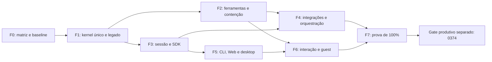

# 0377 — Roadmap para paridade integral

- Programa `PARE100-20261014`. [Plano executivo](0376_plano_executivo_paridade_integral.md), [backlog canônico dos novos cartões](0378_backlog_paridade_integral.md).
- Referência: DeepSeek `0.2.0-rc.1`, commit `768fb1f3d3dcf9a16659ee354e927d05475f22dd`. Escopo integral inclui ferramentas avançadas, aplicações e recursos opcionais distribuídos.
- Estado vigente em15/10/2026: programa `IN_PROGRESS`; P100-001/002 `DONE_LOCAL` após crítica independente, 34 cartões abertos. Baseline C4 integrada e verificada no checkout principal; SDK Python aprovado e em qualificação integrada R6. SPEC0217 aguarda revisão humana T3. Paridade integral `NOT_MEASURED`; produção `NO_GO`.

Checkpoint atual: [integração, inventário e Python](../04_audit/0615_pare100_inventory_and_python_execution_2026-10-15.md). Limpeza348 e baseline local aceitas; fonte113 integrada, builds/type/lint/fronteira/smoke compilado PASS. R4 préPython16gatesPASS; R6 comPython em execução. Inventário44132 e118responsabilidades não são equivalência funcional. F0 ainda depende da matriz e do comparador integrais. Próxima fronteira de código217 exige a resposta humana pendente, conforme constituiçãoT3.

## Sequência de fases

| Fase                                                 | Sprints estimados | Entrega e demonstração de saída                                                                                                                                                                | Cartões e dependências                                  |
| ---------------------------------------------------- | ----------------- | ---------------------------------------------------------------------------------------------------------------------------------------------------------------------------------------------- | ------------------------------------------------------- |
| F0 — Base, inventário e contrato da medida           | 1–2               | Inventário por capacidade, tools/eventos/protocolos/perfis; baseline de ambos; comparador conhecido-bom/conhecido-ruim; dívida PDSH-031 e lint registrada/fechada; cleanup manifesto conferido | P100-001..004; PDSH-031 e AUD0611-G03                   |
| F1 — Caminho único e retirada do legado              | 2–3               | API e worker executam cenário publicado pelo mesmo kernel; consumidores preservados na transição; rotas/workspaces legacy retirados e host compila sem `legacy/`                               | PDSH-003b; P100-010..012; F0 e SPECs T3                 |
| F2 — Modelos, armazenamento, ferramentas e contenção | 3–4               | Streaming/multimodal controlado; backends e stores; fs/doc/binary/PTY e grants reais; execução positiva e negativa nos SOs suportados                                                          | P100-014/015/022..024; AUD0611-G02; F1                  |
| F3 — Sessão, contexto e integradores                 | 2–3               | Restart/fork/consulta/compactação e usage reconstruídos; cliente em outro processo TS/Python; fluxos ACP/SSH e versões incompatíveis recusadas                                                 | P100-020/021/025/026; AUD0611-G01; PDSH-021..025, F1/F2 |
| F4 — Integrações e orquestração                      | 3–5               | MCP/Web/LSP, children com autoridade/budget herdados, PTC Node/Python e workflow; teams/mailbox, goals/todos e jobs/schedule/webhooks retomam após crash sem efeito duplicado                  | P100-030..038; F2/F3                                    |
| F5 — Hosts e experiência de aplicação                | 2–3               | CLI/headless e perfis; Web completo para jornadas da matriz, desktop e gerenciamento de configuração/credenciais/plugins; reconexão e aprovação humana com resultados coerentes                | P100-040..042; F3; contratos F4                         |
| F6 — Providers de interação e runtime estendido      | 2–3               | Browser/computer use em workspace sintético; voz editável; guest Web Worker; extensão Host/Client e diagnósticos com lifecycle limitado                                                        | P100-043..046; F2/F3/F5                                 |
| F7 — Paridade comprovada e distribuição              | 1–2               | Todos os requisitos PASS_CURRENT; gates CI obrigatórios; replay/diferenciais, recuperação, carga e artefato distribuído; crítica independente e pacote de decisão de paridade                  | PDSH-032/033; P100-050..053; todas as fases             |

Os intervalos por fase não devem ser somados como calendário quando houver lanes independentes. Estimativa integrada inicial: 16–24 sprints de duas semanas, com equipe disponível como descrito em 0376. Reestimar em F0 e após dois sprints; nenhuma data de GO está prometida.

## Caminho crítico e paralelismo

F2 e F3 podem compartilhar calendário depois que F1 congelar contratos. F5 pode começar por uma fatia de sessão/approval após F3, sem depender de todos os plugins F4. F6 usa interfaces já congeladas. Paths compartilhados, schema, lockfile, cert e ledgers sempre têm um integrador; não paralelizar writers nesses arquivos.

## Primeiro sprint executável

1. Conferir pins e a limpeza P100-001; resolver o lint preexistente com o owner PDSH-031 e concluir seus gates faltantes. Não confundir entrega documental com fechamento do cartão de código existente.
2. Executar P100-003: validar os 318 manifests e 55 famílias, aplicativos, Python, native, config e catálogos; expandir critérios por método, tool, evento, backend e jornada.
3. Após a infra PDSH-032 pronta, executar P100-004: gravar sessões keyless em home sintética própria, comparar saída e efeitos e provar que uma fixture deliberadamente divergente falha. Enquanto a dependência estiver aberta, preparar as fixtures e o contrato do comparador, sem declarar sua execução.
4. Preparar SPECs T3 de PDSH-003b/P100-010, AUD0611-G02 e AUD0611-G01 com contratos, estados de erro, migração e rollback. Entregar os candidatos concretos para revisão antes de BUILD.

O sprint termina com denominador revisável, baseline medido e primeiras SPECs prontas. Não termina com a declaração antecipada de paridade.

## Gate de cada sprint

- Planejamento/documentação T1: links, formatação, inventário/dependências coerentes e ledgers próprios.
- Implementação T2/T3: SPEC, task, claim, typecheck/lint/unit/PG/E2E atuais; conformidade de controle e isolamento verdes; checks adicionais da capacidade (wire, syscall, restart, UI ou provider).
- Falha corrente: preservar log e reproduzir; corrigir sob o owner e gate corretos. Não desabilitar caso negativo, diminuir denominator ou atualizar snapshot para aceitar regressão.
- Capacidade sensível/release T4: só candidata congelada com pacote hash-bound e decisão humana. Simulador não valida provider real, e replay de protocolo não valida backend nativo.
- Certificação completa: por candidata e ao fim de rodada com implementação, conforme a constituição, em ambiente isolado sob claim. Não rodar cert compartilhado enquanto houver alterações de outro agente.

## Migração e remoção do legado

Caracterizar API/worker/consumidores → introduzir adaptador compatível sobre kernel → migrar uma jornada e seus testes → demonstrar mixed versions e recuperação → retirar imports/export/rotas → atualizar workspaces/lock/build/CI → retirar arquivos executáveis.

Em P100-011, `legacy/packages/secretary-evals`, `secretary-journeys`, `secretary-profile` só são apagados após todos os consumidores substituídos. Dados, migrations e evidências históricas não são apagados. Documentos históricos continuam ligados ao contexto original, com ponteiro para o sucessor quando necessário; links não devem ser fingidos como atuais.

## Como declarar o marco final

F7 produz matriz congelada, relatório de diferenças zeradas, manifesto da candidata, todos os procedimentos atuais e auditoria independente. O cálculo é requisitos obrigatórios PASS_CURRENT / total obrigatório; deve resultar em 100% sem exceção funcional aberta. Candidato diferente ou referência avançada exige revalidação/delta, não herda a nota anterior.

A candidata local e o produto hospitalar são objetos distintos. Mesmo depois de 100% de paridade, operação real continua seguindo a carteira 0374 e os gates próprios dos produtos.
