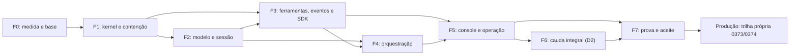

# 0379 — Roadmap de paridade 100% com o DeepSeek Harness

- Task: `PARE100-GAP-20261016-F5` (Claude Code). Pedido do usuário em 16/10/2026: "preciso de um backlog e um roadmap para que o operational-harness alcance 100% de pareamento com o deepseek harness".
- Estado: `APPROVED` pelo usuário em 16/10/2026 (decisões D1 a D7, registro abaixo e na [evidência](../04_audit/evidence/PARE100-GAP-20261016/decisions-d1-d7.json)). Documento T1: define medida, fases, marcos e decisões; não autoriza BUILD, provider real, dado real, push ou deploy. Cada cartão T3 ou T4 continua exigindo sua própria SPEC e revisão.
- Backlog: [0380](0380_backlog_paridade_100_deepseek.md), com 111 cartões. Evidência: [análise de lacunas PARE100-GAP-20261016](../04_audit/evidence/PARE100-GAP-20261016/README.md).
- Referência congelada: DeepSeek `0.2.0-rc.1`, commit `768fb1f3d3dcf9a16659ee354e927d05475f22dd`. Mudança posterior da referência entra como delta separado e não move o alvo sozinha.
- Planos anteriores: este roadmap revisa o [roadmap 0377](0377_roadmap_paridade_integral.md) a partir de uma análise por capacidade, mantém as regras de medição do [plano executivo 0376](0376_plano_executivo_paridade_integral.md) e propõe as mudanças listadas em "Decisões".

## Resumo para decisão

Escopo vigente em 31/10/2026: **272 capacidades**, conforme os [recibos30 e32 e a medida versionada do Q01](0380_backlog_paridade_100_deepseek.md#escopo-par-cap-vigente). O levantamento de 266 e suas estatísticas abaixo são históricos de16/10; não foram recalculados nem promovidos a resultado atual. O freeze do Q01 permanece aberto, a paridade continua `NOT_MEASURED` e a ampliação documental não concede BUILD ou produção.

- **Ponto de partida:** das 266 capacidades da referência levantadas em 16/10, o CVG tem 9 presentes, 76 parciais e 175 ausentes; 6 são divergência deliberada ou não se aplicam. A cobertura indicativa por leitura é de cerca de **18%** (parcial vale meio). Nenhuma capacidade tem ainda `PASS_CURRENT`.
- **Por que não 70%:** a [auditoria 0611](../04_audit/0611_harness_deepseek_pairing_2026-10-14.md) mediu só o motor, com peso alto em governança, onde o CVG é forte. Aqui cada capacidade conta igual e entram interface, orquestração, protocolos e ferramentas, onde o CVG quase não tem nada.
- **Tamanho:** 111 cartões, cerca de **1.440 dias de engenharia** (faixa de 950 a 1.890).
- **Prazo estimado com 5 frentes em paralelo:** paridade hospitalar (tudo menos a cauda F6) em cerca de **13 meses**; paridade integral em cerca de **19 meses**. Com 3 frentes, 21 e 32 meses. Com um executor só, a paridade integral leva anos e não é um plano viável.
- **Cauda de baixo valor:** a fase F6 (desktop, computer use, SSH, ACP, LSP, terminal PTY, guest em Web Worker, backends JSON/SQLite e afins) tem 28 cartões e um terço do esforço, com relevância hospitalar baixa ou nenhuma. Ela fica no plano, e a decisão D2 sobre ela é tomada no marco M3, com dados.
- **Produção é outra trilha:** paridade não concede produção. O núcleo segue a barra [0373](0373_barra_producao_harness.md) e o [plano 0374](0374_plano_producao_harness.md); este roadmap não bloqueia aquela trilha.

## Ponto de partida por grupo

| Grupo                                   | Capacidades | Presentes | Parciais | Ausentes | Divergentes ou N/A |
| --------------------------------------- | ----------- | --------- | -------- | -------- | ------------------ |
| G1 — núcleo, modelo, sessão e contexto  | 50          | 3         | 17       | 30       | —                  |
| G2 — ferramentas, contenção, protocolos | 67          | 1         | 16       | 50       | —                  |
| G3 — orquestração e extensões           | 56          | 0         | 12       | 40       | 4                  |
| G4 — API, SDK, host e operação          | 47          | 2         | 21       | 22       | 2                  |
| G5 — aplicações, interface e interação  | 46          | 3         | 10       | 33       | —                  |
| **Total**                               | **266**     | **9**     | **76**   | **175**  | **6**              |

Lacunas que mais pesam, confirmadas no código:

- O gateway de modelo não faz streaming (`stream: false` nos providers) e a API não tem SSE nem WebSocket. Console ao vivo, SDK com notificações e jobs observáveis dependem disso.
- O Landlock é inferido pela versão do kernel e nenhum ruleset é aplicado. A contenção real hoje é o bubblewrap.
- Não existe subagente, workflow, goal/plano/todo, job de agente, agendamento, PTC, MCP, LSP, ACP ou terminal.
- O CVG tem 7 ferramentas e 1 skill. A referência tem dezenas de ferramentas e um console Web completo.

O CVG já tem mais que a referência em identidade de operador com OIDC e sessão em PostgreSQL, RLS por tenant, aprovação e journal de efeitos duráveis, auditoria encadeada por hash, webhooks assinados, pausa com alerta, imagem endurecida e prova de restore. Esses pontos não contam para a paridade, mas toda capacidade nova precisa preservá-los (ADR-011).

## O que significa 100% (decisões D1, D2 e D4)

1. **Denominador:** o escopo autorizado do catálogo PAR-CAP v1 tem 272 capacidades; sua revisão e freeze continuam abertos no PAR-Q01. Cada capacidade exige fonte na referência, procedimento de aceite e cartão. As 44.132 folhas estáticas da matriz P100-003 ficam como rastreabilidade de cada capacidade, não como denominador. Uma folha estática não é um comportamento testável.
2. **Numerador:** capacidades com `PASS_CURRENT` no medidor PAR-Q05. `PARTIAL`, `NOT_RUN`, `BLOCKED` e exceção pendente não contam. Uma falha de autorização, isolamento, efeito duplicado ou recuperação bloqueia o aceite mesmo com percentual alto, como no 0376.
3. **Classes de capacidade:**
   - `EQUIVALENTE`: mesmo comportamento observável.
   - `EQUIVALENTE_GOVERNADA`: mesmo resultado para o usuário, passando pelos controles do CVG. Exemplos: shell por argv com aprovação, em vez de `bash -c` livre; plugins de catálogo revisado, em vez de instalação de registro público em runtime; PostgreSQL como fonte de verdade com export e import JSONL; loop do kernel com modos, em vez de loop trocável por configuração.
   - `DIVERGENTE_DECIDIDA`: fora do denominador por decisão registrada (ADR), com a medida renomeada para "100% do escopo decidido". Nenhuma capacidade entra nesta classe sem decisão do usuário.
4. **Comparação:** o comparador diferencial (PAR-Q02) roda as duas implementações em home sintética, sem chave e sem dado real, e só normaliza IDs, tempo e transporte declarados.

## Fases

As fases seguem dependência e valor hospitalar. Cartões começam quando as dependências estão prontas, não quando a fase anterior inteira termina.

| Fase | Objetivo                                                                                      | Cartões | Esforço (dias) | Demonstração de saída                                                                                      |
| ---- | --------------------------------------------------------------------------------------------- | ------- | -------------- | ---------------------------------------------------------------------------------------------------------- |
| F0   | Medida, comparador, kit de testes e trabalho em curso preservado                              | 6       | 38             | Catálogo PAR-CAP v1 congelado; medidor publica a linha de base real; comparador reprova casos adulterados  |
| F1   | Um só pipeline, checkpoint durável, lifecycle de capabilities e contenção real                | 13      | 174            | API, worker e execução publicada pelo mesmo kernel; crash no efeito sem duplicata; Landlock aplicado       |
| F2   | Streaming, sessão entre processos, projeções, consulta, compactação e spill                   | 16      | 141            | Turno longo compactado sem perder aprovação; fork e consulta com rastreio aprovação → efeito               |
| F3   | Ferramentas de arquivo, anexos, skills, web, MCP, stream de eventos na API e SDK completo     | 18      | 181            | Cliente TS e Python acompanham turno por stream, com aprovação, cancelamento e reconexão sem duplicata     |
| F4   | Subagentes, jobs, agendamento, webhooks, workflow, goal/plano/todos e PTC                     | 11      | 186            | Lembrete agendado sobrevive a restart e entrega uma vez; filho nunca excede o grant do pai                 |
| F5   | Console ao vivo, CLI, configuração, credenciais, voz, feedback e inspeção                     | 15      | 204            | Equipe conversa, aprova e acompanha jobs no console; transcrição revisável; rotação de credencial a quente |
| F6   | Cauda integral de baixa relevância hospitalar (decisão D2)                                    | 28      | 469            | Cada capacidade restante `PASS_CURRENT` ou `DIVERGENTE_DECIDIDA` registrada                                |
| F7   | Gates de paridade no CI, recuperação e carga, candidata reproduzível e auditoria independente | 4       | 46             | Medidor em 100% no escopo decidido, sem exceção aberta, com auditoria independente                         |

## Marcos e calendário

Os dias são equivalentes de engenharia humana e incluem SPEC curta, revisão e gates. O calendário considera frentes trabalhando em paralelo com eficiência de 70% (integração, revisão e espera de gate) e nunca fica abaixo do caminho crítico. Datas indicativas supõem início em 02/11/2026, logo depois das decisões.

| Marco                          | Escopo           | Cartões | Esforço (dias)    | Caminho crítico | 3 frentes         | 5 frentes        | Data indicativa (5 frentes) |
| ------------------------------ | ---------------- | ------- | ----------------- | --------------- | ----------------- | ---------------- | --------------------------- |
| M1 — Motor unificado e contido | F0 + F1          | 19      | 212 (139–276)     | 14 semanas      | 20 sem. (14–26)   | 14 sem. (14–16)  | fevereiro de 2027           |
| M2 — Motor equivalente         | F0 a F3          | 53      | 534 (347–688)     | 23 semanas      | 51 sem. (33–66)   | 31 sem. (23–39)  | junho de 2027               |
| M3 — Paridade hospitalar       | F0 a F5 + F7     | 83      | 970 (637–1.268)   | 39 semanas      | 92 sem. (61–121)  | 55 sem. (39–73)  | novembro de 2027            |
| M4 — Paridade integral 100%    | todos os cartões | 111     | 1.439 (950–1.890) | 41 semanas      | 137 sem. (91–180) | 82 sem. (54–108) | maio de 2028                |

Leitura do calendário:

- Com 5 frentes, o intervalo de M4 vai de novembro de 2027 a novembro de 2028. Com 3 frentes, M4 fica entre meados de 2028 e 2030.
- O [plano 0376](0376_plano_executivo_paridade_integral.md) estimou 8 a 12 meses antes de medir as lacunas. A análise por capacidade mostra 175 capacidades ausentes. Mantido o tamanho dos cartões, aquela estimativa só se confirma se os agentes entregarem cerca de duas vezes a velocidade de uma equipe humana equivalente.
- Agentes podem codificar mais rápido que pessoas, mas o PARE100 entregou 2 cartões de higiene em três dias com o processo atual. A velocidade real (dias estimados entregues por semana) será medida nos dois primeiros sprints e o calendário recalculado com ela. Até lá, as datas acima são a referência.
- O caminho crítico de M3 é PAR-G01 → PAR-K01 → PAR-K03 → PAR-S01 → PAR-A01 → PAR-O03 → PAR-O04 → PAR-U03 → PAR-Q06 → PAR-Q07 → PAR-Q09. Ele encurta se os contratos de PAR-K03, PAR-S01 e PAR-A01 forem congelados cedo, para que os dependentes comecem sobre o contrato e não sobre a entrega final.

## Primeiro sprint (duas semanas)

1. **PAR-G01:** o Codex faz commit, em branch própria, do trabalho da worktree em `/tmp` e integra a migration 0029. Os cinco gates T3 pendentes foram decididos em 16/10/2026 (0221, 0222 e 0225 aprovadas com ajustes; 0220 e 0226 adiadas), [registro](../04_audit/evidence/USER-DECISIONS-20261016/spec-gates.json).
2. **PAR-Q01 e PAR-Q05:** concluir a revisão e congelar o catálogo PAR-CAP v1 no escopo autorizado de 272 capacidades, depois publicar o medidor com a linha de base real.
3. **Em paralelo, com caminhos disjuntos:** PAR-K01 continua com o Codex (dono do P100-010); PAR-X01 e depois PAR-X02 (Landlock real, P0 de segurança, independente do resto); PAR-Q03 (kit de testes).
4. **Saída do sprint:** denominador congelado, medidor com número real, serviço de subprocesso integrado e contrato do Landlock revisado. Nada de declaração antecipada de paridade.

## Decisões

Decididas pelo usuário em 16/10/2026, todas com a opção recomendada. Em D4 as quatro equivalências propostas foram aceitas. A tabela abaixo é o texto apresentado para decisão.

| ID  | Decisão                                                                                                                                         | Recomendação                                                                                         | Impacto se não decidir                                     |
| --- | ----------------------------------------------------------------------------------------------------------------------------------------------- | ---------------------------------------------------------------------------------------------------- | ---------------------------------------------------------- |
| D1  | Denominador: catálogo PAR-CAP v1 por capacidade, com as 44.132 folhas como rastreabilidade                                                      | Aprovar. Exige registrar a mudança de medida, como pede a regra 4 do 0376                            | Continua `NOT_MEASURED`; o progresso não é verificável     |
| D2  | Escopo da cauda F6: 100% literal, ou "100% do escopo decidido" com parte da F6 como `DIVERGENTE_DECIDIDA`                                       | Manter a F6 no plano e decidir no M3, com medidor e custo reais                                      | Nenhum agora; a F6 vem por último                          |
| D3  | Processo proporcional: uma revisão independente por cartão, até dois retrabalhos, gates T3 reunidos num pacote semanal                          | Aprovar. Retoma a regra "uma revisão por mudança" da barra 0373; hoje uma fatia chegou à revisão R19 | As estimativas deixam de valer; o calendário pode dobrar   |
| D4  | Lista inicial de `EQUIVALENTE_GOVERNADA` (shell por argv, plugins revisados, PostgreSQL com export JSONL, loop do kernel, workflow declarativo) | Aprovar a lista e decidir cada caso novo na SPEC do cartão                                           | Cartões T3 travam em discussão de equivalência             |
| D5  | Este roadmap e o backlog 0380 passam a ser o plano canônico de paridade; o 0378 vira histórico depois do PAR-G01                                | Aprovar, com o Codex como dono dos cartões absorvidos em andamento                                   | Dois backlogs para o mesmo objetivo, com status divergente |
| D6  | Número de frentes e executores (Codex e sessões Claude), com um integrador único para schema, lockfile, contratos e ledgers                     | 5 frentes com caminhos disjuntos; o integrador é o único que escreve nos arquivos compartilhados     | Com 3 frentes o calendário cresce cerca de 65%             |
| D7  | Trilha de produção do núcleo (0374, fase C) separada da paridade                                                                                | Manter separada: hospedagem, cofre, emissor de token e alerta são decididos à parte                  | Produção espera uma paridade que leva mais de um ano       |

Registro da decisão:

| ID  | Resultado em 16/10/2026                                                                                                                    |
| --- | ------------------------------------------------------------------------------------------------------------------------------------------ |
| D1  | Aprovado: o denominador é o catálogo PAR-CAP v1; a matriz de 44.132 folhas vira rastreabilidade                                            |
| D2  | Aprovado: a F6 fica no plano e o escopo dela é decidido no marco M3                                                                        |
| D3  | Aprovado: processo proporcional, uma revisão independente por cartão, até dois retrabalhos, gates T3 num pacote semanal                    |
| D4  | Aprovado: shell por argv com aprovação, plugins de catálogo revisado, PostgreSQL com export JSONL, loop do kernel e workflow declarativo   |
| D5  | Aprovado: 0379 e 0380 são o plano oficial de paridade; o 0378 vira histórico depois do PAR-G01; o Codex continua dono dos cartões em curso |
| D6  | Aprovado: 5 frentes com caminhos disjuntos e integrador único para schema, lockfile, contratos e ledgers                                   |
| D7  | Aprovado: produção do núcleo (0374) segue separada da paridade                                                                             |

## Gates por cartão

- T1 (catálogo, medidor, documentos): formatação e links verdes; ledgers atualizados.
- T2 (kit de testes, CLI, contratos internos): SPEC curta, typecheck, lint, unit, PostgreSQL e E2E verdes em Node 22.
- T3 (contrato público, schema, segurança, policy, approval): T2 mais revisão da SPEC pelo usuário antes do BUILD, no pacote semanal (D3).
- T4 (provider, canal, rede ou dado real; candidata): gate hash-bound, certificação completa e decisão humana. Fixture e simulador não validam provider real.
- Toda capacidade aprovada ganha caso no comparador diferencial e no gate de paridade do CI (PAR-Q06). Uma regressão derruba o CI.

## Riscos

| Risco                                                                            | Mitigação                                                                                               |
| -------------------------------------------------------------------------------- | ------------------------------------------------------------------------------------------------------- |
| Estimativa otimista ou pessimista (tamanhos por leitura, sem execução)           | Recalibrar com a velocidade dos dois primeiros sprints; publicar o desvio                               |
| Processo de crítica sem limite consome o calendário                              | D3: uma revisão e até dois retrabalhos por cartão                                                       |
| Capacidades novas abrem superfície de execução (MCP, PTC, shell, browser, hooks) | PAR-X01 a PAR-X03 antes delas; tudo passa pelo kernel com controles obrigatórios e allowlist por tenant |
| Efeito duplicado em retry, reconexão, agendamento e jobs                         | PAR-K03 e PAR-S01 no caminho crítico; caso negativo de duplicata em todo cartão com efeito              |
| Dado pessoal em anexos, voz, busca e exportação                                  | Retenção e redação antes de qualquer envio; rede e provider real só em T4                               |
| Referência DeepSeek muda (é release candidate)                                   | Pin congelado; mudanças entram como delta com nova versão do catálogo                                   |
| Trabalho em andamento perdido (`/tmp` é limpo no boot)                           | PAR-G01 no primeiro dia do sprint                                                                       |
| Vários agentes no mesmo checkout                                                 | Claim por cartão, caminhos disjuntos, integrador único (D6)                                             |

## Continuidade

- O medidor PAR-Q05 publica o percentual por família toda semana. O roadmap é revisto ao fim de cada marco e depois dos dois primeiros sprints.
- Mudança de escopo, de classe de capacidade ou da referência entra como decisão registrada e nova versão do catálogo.
- O consumo do motor pelo Assistente de Plantão (PDSH-026) e a barra 0368 continuam na carteira do produto (ADR-010).
- Para retomar: ler 99/20/30, a [coordenação](../08_runtime/agent_coordination.md), este roadmap, o backlog 0380 e a evidência PARE100-GAP-20261016; conferir o pin da referência; escolher um cartão com dependências prontas e registrar o claim.
