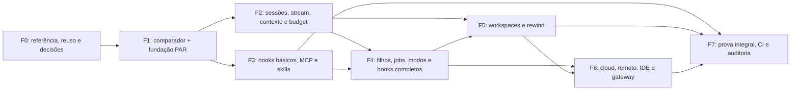

# 0382 — Roadmap de paridade funcional Claude Code

Programa `CLAUDE100`, 17/10/2026. [Plano executivo 0381](0381_plano_executivo_paridade_claude_code.md) define escopo, referência, medida e autoridade. [Backlog 0383](0383_backlog_paridade_claude_code.md) contém estado e dependências C100; [0380](0380_backlog_paridade_100_deepseek.md) continua proprietário dos PAR; [catálogo](tracking/claude100_catalog_v1.json) contém os 134 requisitos iniciais obrigatórios das 16 famílias:117 resultados comparáveis e17controles CVG, com oráculos distintos e conclusão conjunta. Estado do roadmap: proposto, sem BUILD iniciado.

## Regra de sequenciamento

Executar por capacidade demonstrável, com dependências satisfeitas e gates próprios. Fases não são barreiras artificiais: pesquisa de cloud/IDE/gateway começa em F0; implementação remota ocorre depois da fundação e da decisão T4. Um cartão pode começar antes de a fase anterior inteira terminar, mas não antes do contrato e da prova necessários.

Todo marco é uma entrega intermediária; **somente M7 cobre 100% do alvo**. Nenhuma fase é retirada por relevância hospitalar, esforço ou disponibilidade da conta de referência. As classificações P1/P2/P3 da análise 0618 não reduzem o escopo solicitado.

## Fases e demonstrações

Os dias abaixo são apenas deltas C100; dependências PAR são compartilhadas e contadas separadamente no modelo do 0381. Paths definitivos, APIs e migrations são definidos nas SPECs, antes de código.

| Fase                         | Cartões novos                           | ROM delta (dias) | Resultado demonstrável e dependências principais                                                                                                                  |
| ---------------------------- | --------------------------------------- | ---------------- | ----------------------------------------------------------------------------------------------------------------------------------------------------------------- |
| F0 — Medida e decisões       | G01–G04 (4)                             | 10–18            | Pin e fontes conferidos; 16 famílias decompostas; oráculos/acessos definidos, reuso reconciliado e Discovery/PRD/SPEC encaminhados.                               |
| F1 — Comparador e fundação   | Q01 (1) + reuso PAR                     | 10–20            | Comparador aceita controle correto autenticado e rejeita adulteração; a jornada M1 com PAR-K01/K03/S01/X01–X04 é dependência explícita antes de consumidores.     |
| F2 — Continuidade e contexto | S01/S02, C01/C02, B01/B02 (6)           | 38–78            | Sessão sobrevive a processo, fork conserva linhagem, stream termina uma vez, memória tem origem e budget agregado resiste a corrida/restart.                      |
| F3 — Extensões               | K01, T01/T02, P01/P02, E01/E02 (7)      | 41–86            | Skill progressiva, plugin revisado, MCP cliente/servidor e hooks básicos atravessam controles; eval compara com/sem extensão.                                     |
| F4 — Autonomia e operação    | O01/O02/O03, L01, H01/H02, K02, W01 (8) | 41–85            | Subagentes, jobs, planos e perfis operáveis; hooks de agente/modelo usam supervisor, não executor paralelo fora do kernel.                                        |
| F5 — Workspaces e rewind     | W02, U01/U02 (3)                        | 18–37            | Worktree isolado, add-dir e terminal têm posse; restore seletivo detecta conflito e informa limitações.                                                           |
| F6 — Superfícies remotas     | R01–R04 (4)                             | 45–96            | Cloud/self-hosted, controle remoto consentido, IDE/desktop e gateway demonstrados com referência acessível e ambiente autorizado.                                 |
| F7 — Qualificação e aceite   | Q02–Q05 (4)                             | 27–52            | 117 resultados comparáveis com referência/CVG e17controles por SPEC/prova CVG, no mesmo candidato; carga/recuperação, CI, auditoria independente e decisão final. |
| Total de deltas              | 37                                      | 230–472          | Dependências PAR adicionais não estão escondidas nesse total.                                                                                                     |



O desenho resume a ordem; dependências exatas por task estão no 0383. Por exemplo, P02 em F3 depende de S02 em F2; K02 só fecha em F4 depois de O01. W01 também ocorre em F4, antes do remove de sessão/worktree em O02; W02 e o rewind ficam em F5. Pesquisa e preparação documental remota não esperam F6. A caminhada inicial F1 é requisito de entrada a novas capacidades, mesmo quando o suporte dela vem de múltiplos PAR em fases distintas.

## Marcos e critério de saída

| Marco                                 | Demonstração requerida                                                                                    | Condição para sair                                                                                                                      |
| ------------------------------------- | --------------------------------------------------------------------------------------------------------- | --------------------------------------------------------------------------------------------------------------------------------------- |
| M0 — Alvo comparável                  | Catálogo e contratos de teste percorridos contra fontes reais; acesso de referência remoto com dono.      | G01–G04 concluídos documentalmente; nenhum requisito sem fonte/procedimento/dono; gates de cada BUILD aprovados antes de começá-lo.     |
| M1 — Jornada mínima governada         | Abrir sessão, READ, WRITE retida, approval autenticado, retomada e restart sem efeito extra.              | Q01 e fatias relevantes PAR-K01/K03/S01/X01–X04 qualificadas; comparador rejeita resultado conhecido como errado.                       |
| M2 — Continuidade útil                | Cliente recebe stream, reconecta, seleciona/forka sessão e conserva pendências/contexto; custo persiste.  | Requisitos F2/PAR correspondentes `PASS_CURRENT`, incluindo positivos/negativos e revisão; não implica família remota completa.         |
| M3 — Ecossistema governado            | Conectar MCP sintético, invocar skill progressiva, validar plugin e comparar ablação.                     | Discovery não concede grant; handlers confirmados e transportes cobertos; servidor MCP do host interoperável; promoção exige evidência. |
| M4 — Autonomia supervisionada         | Spawn especializado, mailbox, job background/respawn, stop da árvore, plano read-only e modo diagnóstico. | Grants não ampliam; teto agregado preservado; cancelamento e falha dupla têm resultado honesto e auditável.                             |
| M5 — Desenvolvimento recuperável      | Worktree/PTY próprios, conflito de restore detectado e rewind seletivo demonstrado.                       | Sem perda de trabalho alheio; histórico preservado; limites de shell/filhos e retenção explícitos.                                      |
| M6 — Paridade das superfícies remotas | Usuário autorizado cria/anexa cloud, pareia/revoga cliente, usa IDE/desktop e passa pelo gateway.         | Quatro cartões R têm referência funcional validada; mock local não fecha marco remoto.                                                  |
| M7 — 100% qualificado                 | Medidor, candidata e pacote de decisão conferidos por auditor independente.                               | Todos os requisitos atuais aprovados, 16/16 famílias, zero exceção aberta e controles verdes; decisão humana registrada.                |

Não há percentuais artificiais atribuídos aos marcos. O percentual funcional considera os117resultados comparáveis com receipts válidos; os17controles adicionais têm seu próprio gate obrigatório com SPEC/provas CVG; um marco não acrescenta automaticamente uma fração fixa de progresso.

## Caminhos críticos e dependências herdadas

O grafo inclui 37 deltas C100 e 58 PAR únicos no fecho conservador, sem contar carriers opcionais como dependências obrigatórias. O caminho crítico nominal inicial é:

```text
PAR-G01 → PAR-K01 → PAR-K03 → PAR-S01 → PAR-A01
→ PAR-O03 → PAR-A04 → C100-O02 → C100-R01
→ C100-R02 → C100-R03 → C100-Q02 → C100-Q03
→ C100-Q04 → C100-Q05
```

Outros bloqueios relevantes:

- K04/K05 habilitam configuração, plugins e skills; X01/X02/X03/T12 habilitam MCP e hooks externos.
- M01 + S01 habilitam A01 e SDK incremental. Não confundir evento paginado com streaming de modelo.
- B01 + S04 + K06 habilitam filhos com custo herdado; O03/A04 habilitam supervisão de background.
- R04/gateway depende de oráculo em G02/G04. Hoje há somente a superfície anunciada; sem confirmação o caminho remoto pode se tornar o crítico.
- Undo depende de workspace e identidade de writer; undo de arquivos não depende de fingir reversão de efeitos externos.

O diagrama de precedência não inclui esperas por revisão, acesso, contas ou indisponibilidade. O caminho muda após G03 validar fatias PAR já integradas. SSH/ACP são candidatos de reuso opcionais, não obrigações técnicas de cloud/IDE.

## Capacidade e horizonte provisório

O modelo assume dias de engenharia humana, cinco dias por semana e 70% de capacidade efetiva: 3,5 dias por frente/semana. Os 625 dias nominais herdados são apenas os 58 cartões completos do fecho, não os 111 do programa DeepSeek. Cada um entra uma única vez; o orçamento global compartilhado não deve somá-los novamente para Claude.

| Frentes totais compartilhadas | Envelope inicial (semanas) | Nominal (semanas) | Leitura correta                                                  |
| ----------------------------- | -------------------------- | ----------------- | ---------------------------------------------------------------- |
| 1                             | 182–376                    | 279               | Cenário de capacidade, sem acelerar dependências nem revisão.    |
| 3                             | 61–126                     | 93                | A capacidade agregada domina a estimativa.                       |
| 5                             | 42–86                      | 64                | O caminho crítico passa a dominar parte importante do horizonte. |

Valores arredondados para cima; o [modelo](../04_audit/evidence/CLAUDE100-PLAN-20261017/plan-index.json) conserva os valores calculados. Estes são limites estimativos, não uma agenda nivelada por recursos nem compromisso de entrega. Não cobrem espera externa e gates. Requalificar entregas existentes pode diminuir o saldo; descobrir semântica adicional pode aumentá-lo. Não há calendário aprovado nem contratação ou compra pressuposta.

Após dois sprints, publicar dias estimados aceitos por semana, lead time, retrabalho e espera. Recalcular prazo com capacidade real e o grafo atualizado, sem mudar a barra de 100%. Datas só são fixadas quando equipe, acessos e gates estiverem disponíveis.

## Primeiro sprint: retirar incertezas e demonstrar o núcleo

Sprint proposto de duas semanas; execução e capacidade nominal ainda não alocadas. Meta principal: catálogo comparável e uma fatia de execução apta a começar, não “paridade pronta”.

1. L0/L5: G01 e G02, conferindo pin, fontes, variantes e oráculos. Mapear desde o primeiro dia o acesso necessário a cloud/IDE/gateway, sem abrir conta ou usar credencial real implicitamente.
2. L0/L1: G03 em paralelo documental, conferindo o que já foi integrado, aceito e rejeitado nas candidatas/worktrees. Não desfazer ou mover trabalho ativo de outro agente.
3. L0 com os donos: G04 consolida Discovery/PRD, escolhas de equivalência e primeiras SPECs. Preparar pacote concreto para gates, sem tratar aprovação de plano como autorização de código.
4. Com contratos e gates já liberados, iniciar Q01 e os PAR de fundação disponíveis. Se o gate não chegar no sprint, entregar documentação e probe de fonte permitida; registrar a espera e não iniciar BUILD dependente.

Saída mínima: todos os requisitos com origem/procedimento/dono, reuso reconciliado, riscos remotos com ação, primeira SPEC concreta revisável. Saída estendida, condicionada aos gates: comparador executável e jornada mínima com provas de negativa e restart.

## Frentes, concorrência e integração

| Frente               | Papéis no backlog | Regra de coordenação                                                                                           |
| -------------------- | ----------------- | -------------------------------------------------------------------------------------------------------------- |
| A — núcleo/dados     | L0 + L1           | Integrador acumula liderança; escreve contratos, schema/migrations e ledgers em janela exclusiva.              |
| B — interfaces       | L2                | API/SDK/CLI, modos, configuração, IDE e controle remoto; contratos congelados antes de implementação paralela. |
| C — extensões        | L3                | MCP, hooks, skills/plugins; não toca gates obrigatórios sem claim/SPEC correspondente.                         |
| D — supervisão/hosts | L4                | Filhos, jobs, workspaces, PTY e host cloud; processos, ports e recursos próprios por claim.                    |
| E — qualificação     | L5                | Oráculos, negativos, métricas e revisão; quem constrói um requisito não emite sua aprovação independente.      |

São cinco frentes compartilhadas, não seis papéis de tempo integral. Se falta independência, rodar revisão em sessão separada ou redistribuir uma frente e refletir isso no calendário. Fila, lockfile, schema, catálogos e artefatos de certify/E2E têm um writer por janela.

## Gates de marco e observação do progresso

M0 prepara decisões; T3 continua exigindo revisão humana da SPEC antes do BUILD. Qualificação externa/candidata segue T4. Certify, PostgreSQL e E2E rodam em snapshot/claim próprio com Node22, sem regravar artefatos de outra sessão. Cada mudança com código encerra com os gates aplicáveis; esta rodada documental não executou tais gates.

O painel de acompanhamento deve mostrar por família: total obrigatório, referência funcional confirmada, `PASS_CURRENT`, pendentes, bloqueados e stale; por tarefa: dono, dependências e next action no backlog canônico; por candidato: SHA/digest e inputs. Não somar notas de paridade Claude e DeepSeek nem conceder aceite por média.

Pontos de replanejamento: fim de G03; dois primeiros sprints; mudança da referência; incompatibilidade de conta/serviço; falha de controle; dois retrabalhos rejeitados; delta de escopo. Replanejar preserva IDs, falhas e denominador original, com decisão explícita quando houver alteração.

## Próxima ação

Executar **C100-G01** na trilha documental, depois G02/G03. Os estados de execução estão no 0383 e nos PAR originais. A candidata estável e a [produção 0374](0374_plano_producao_harness.md) permanecem em trilha própria; nenhum marco autoriza dados reais, push ou deploy por inferência.
