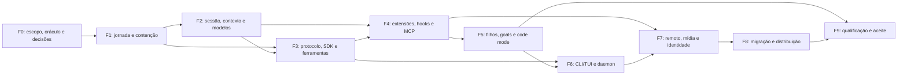

# 0385 — Roadmap de paridade funcional Codex

Programa `CODEX100`, 17/10/2026. O [plano 0384](0384_plano_executivo_paridade_codex.md) define alvo, medida e autoridade; o [backlog 0386](0386_backlog_paridade_codex.md) contém estados DX100; o [catálogo](tracking/codex100_catalog_v1.json) registra 22 famílias, 379 obrigações funcionais e 22 controles iniciais. Estado: execução proposta, sem BUILD iniciado.

Cada fase entrega comportamento demonstrável. Prioridade define ordem, sem retirar funções da meta. Somente M9 pode encerrar os 100%, no rótulo aprovado e sem pendência de escopo ou evidência.

## Fases e demonstrações

| Fase                                  | Cartões DX100                     | ROM delta (dias) | Demonstração                                                                                                                          |
| ------------------------------------- | --------------------------------- | ---------------- | ------------------------------------------------------------------------------------------------------------------------------------- |
| F0 — Escopo, referência e decisões    | G01, G02, G03, G04                | 15–30            | Catálogo e variantes conferidos; referência vinculada; reuso e primeira SPEC decididos. Pesquisa de remoto e plataformas começa aqui. |
| F1 — Jornada e execução contida       | Q01, K01, X01, X02, X03           | 48–105           | Sessão → READ → WRITE retida → approval → retomada/restart; supervisor e contenção; caso adulterado reprovado.                        |
| F2 — Continuidade, contexto e modelos | S01, S02, C01, C02, M01, M02, H01 | 64–140           | Consulta/fork/metadata/contexto/compactação e provider sob pressão/restart; orçamento e origem preservados.                           |
| F3 — Protocolo, SDK e ferramentas     | A01, A02, A03, D01, D02, T01, W02 | 67–144           | Requests, notificações e approvals bidirecionais, filesystem/exec, SDK, headless e review com execução nativa.                        |
| F4 — Extensões, hooks e MCP           | E01, E02, F01, P01, P02           | 56–122           | Skill, plugin, hook, MCP e app/widget revisados atravessam capabilities; trust e cancelamento demonstrados.                           |
| F5 — Autonomia e code mode            | T02, O01, O02                     | 35–74            | Árvore/mailbox, goals/planos/filas e code mode com limite agregado e stop de recursos próprios.                                       |
| F6 — CLI/TUI, workspaces e daemon     | H02, W01, U01, U02, R01, V01      | 63–138           | CLI/TUI completas, worktree e terminal próprios, preferências/pets, daemon e observabilidade.                                         |
| F7 — Remoto, mídia e identidade       | R02, R03, I01, I02, I03, N01      | 106–230          | Exec-server em outro host; cloud/IDE/gateway, mídia/automação e identidade com referência acessível e ensaio autorizado.              |
| F8 — Migração e distribuição          | Z01, Z02                          | 22–48            | Migração sem perda e artefatos instaláveis/atualizáveis/recuperáveis nas plataformas contratadas.                                     |
| F9 — Qualificação e aceite            | Q02, Q03, Q04, Q05                | 46–96            | Todas as variantes atuais, fault injection/carga, CI com negativos, auditoria independente e decisão final.                           |



O diagrama resume precedência; o DAG por tarefa é a referência exata. As fases não são barreiras artificiais: M01 pode começar com K01; W02 ocorre em F3 antes de D02; R01 em F6 precede H02; T02 exige O01; N01 e I03 exigem os controles prévios. Pesquisa de acesso remoto e runners começa em F0, mesmo quando o ensaio ocorre em F7/F8.

## Marcos e critérios de saída

| Marco                         | Demonstração e condição de saída                                                                                                                        |
| ----------------------------- | ------------------------------------------------------------------------------------------------------------------------------------------------------- |
| M0 — Alvo íntegro             | G01–G04: fontes, variantes, oráculos e donos conferidos; referência executável vinculada; reuso reconciliado e primeira SPEC pronta para o gate.        |
| M1 — Execução comum           | Q01/K01 e fatias X/PAR necessárias: jornada sintética com approval e restart; controle conhecido como errado reprovado.                                 |
| M2 — Continuidade             | S/C/M/H01: histórico, fork, metadata, contexto, budget e provider sob o mesmo contrato; componentes existentes requalificados.                          |
| M3 — Interfaces e ferramentas | A/D/T01/W02: contratos protocolares, SDK, headless, arquivos e review qualificados nas variantes pertinentes; sem fingir acesso externo ainda pendente. |
| M4 — Extensibilidade          | E/F/P: trust de conteúdo, callbacks, elicitação e widgets com ownership; descoberta e instalação não concedem grant.                                    |
| M5 — Autonomia                | O/T02: filhos, filas/goals e programas do modelo com supervisor, budgets e isolamento; cancelamento nas fronteiras.                                     |
| M6 — Operação por pessoas     | H02/U/R01/V01/W01: CLI/TUI, daemon, workspaces, preferências e diagnóstico com reconexão e consentimento.                                               |
| M7 — Superfícies externas     | R02/R03/I/N: referência e CVG ensaiados em host, mídia, automação e identidade autorizados; mocks não fecham esse marco.                                |
| M8 — Distribuição recuperável | Z01/Z02: migração, instalação, atualização, rollback e plataformas com artefatos reproduzíveis e origem conferida.                                      |
| M9 — 100% qualificado         | Q02–Q05: todas as 22 famílias, variantes, superfícies e controles na candidata atual; escopo fechado, auditoria independente e decisão humana.          |

Uma família sem oráculo ou variante inacessível permanece pendente mesmo após M8. Não atribuir frações fixas de progresso aos marcos. “100% literal” e “100% governado” seguem as definições distintas do 0384, sem equivalência silenciosa de bypass ou ação sensível.

## Dependências e caminho crítico

Caminho crítico nominal provisório:

```text
PAR-G01 → PAR-K01 → PAR-K03 → PAR-S01 → PAR-A01 → PAR-O03 → PAR-T10 → PAR-T14 → SHARED:C100-W02 → DX100-X01 → DX100-X02 → DX100-P01 → DX100-P02 → DX100-U01 → DX100-R03 → DX100-Z02 → DX100-Q02 → DX100-Q03 → DX100-Q04 → DX100-Q05
```

O [modelo derivado](../04_audit/evidence/CODEX100-PLAN-20261017/plan-index.json) contém 170 nós deduplicados: 49 DX100, 93 PAR e 28 fatias técnicas C100 propostas. G03 precisa aceitar os limites, gates e saldos dessas fatias antes de agendar execução. Reutilizar uma fatia não exige qualificar a referência Claude inteira, mas exige seus aceites técnicos atuais.

Dependências de maior risco: sandbox nativo por SO; referência executável vinculada à fonte; provider, voz, remoto e entitlements; schema/approval/identidade T3; escritor único de contratos, migrations e lock; UI/headless consumindo capacidades reais. Ausência de uma dependência não autoriza substituir um handler por stub para passar o contrato.

## Capacidade e horizonte provisório

Deltas DX100: **522–1127 dias**. Reuso PAR: **1142 dias nominais**. Reserva C100: **183–382 dias**. Envelope conservador deste alvo: **1448–3051 dias**, contando cada unidade uma vez. Não é orçamento incremental para uma carteira já financiada.

| Frentes totais compartilhadas | Semanas: mínima / nominal / máxima |
| ----------------------------- | ---------------------------------- |
| 1                             | 414 / 643 / 872                    |
| 3                             | 138 / 215 / 291                    |
| 5                             | 83 / 129 / 175                     |

Usar 3,5 dias efetivos por frente/semana e o máximo entre capacidade e caminho crítico. O cenário não nivela recursos nem inclui espera por contas, gates e runners. Não há datas contratuais ou equipe concedida. Reestimar após G03 e dois sprints; novas variantes podem ampliar o saldo sem mudar silenciosamente o alvo.

## Primeiro sprint proposto — duas semanas

1. L0/L5: G01 percorre schemas, dispatchers, configuração aninhada, CLI/TUI, exports, tools e condições por SO. Preservar IDs e registrar divergências.
2. L5/L4: G02 vincula fonte e executável e define o plano de runners/acesso. G03 reconcilia o reuso em paralelo documental, sem tocar worktrees e claims alheios.
3. L0: G04 consolida Discovery/PRD e uma SPEC concreta da jornada mínima, com decisões explicadas e gate aplicável antes do BUILD.
4. Com gates e recursos disponíveis, iniciar Q01 e as fatias de núcleo correspondentes. Se o gate não chegar no sprint, entregar catálogo/pacote/handoff e registrar espera, sem começar a construção dependente.

Saída mínima: requisitos com fonte, método de prova e dono; referência resolvida ou bloqueio externo com responsável e ação concreta; reuso reconciliado e primeira SPEC revisável. Saída estendida, condicionada aos gates: comparador executável e jornada que rejeita adulteração.

## Frentes e integração

| Frente compartilhada | Papel | Regra                                                                               |
| -------------------- | ----- | ----------------------------------------------------------------------------------- |
| A — Núcleo/dados     | L0+L1 | Integrador acumula liderança; contratos, schema e ledgers têm janela exclusiva.     |
| B — Interfaces       | L2    | API, SDK, CLI e TUI; contratos congelados antes da escrita paralela.                |
| C — Extensões        | L3    | MCP, hooks, skills, apps e mídia; capabilities não fornecem controles obrigatórios. |
| D — Hosts/supervisão | L4    | SO, processos, remoto e workspaces; recursos próprios por claim.                    |
| E — Qualificação     | L5    | Oráculos, negativos, CI e revisão; construtor não aceita o próprio requisito.       |

São cinco frentes totais compartilhadas com PAR/C100, não cinco equipes por programa. Claims disjuntos e integração única antecedem código. Se faltar capacidade ou independência, resequenciar e refletir a limitação no calendário.

## Retomada e próxima ação

Estados e próximas ações estão no 0386; provas ficam nos recibos do medidor e inputs com hash. Antes de selecionar DX100-G01, conferir instruções, coordenação, ledgers, checkout, claims e gates. Produção segue 0374; SPEC0228, isolamento e programas anteriores mantêm suas decisões e condições. Esta entrega de planejamento não concede BUILD T3/T4, conta externa, push ou deploy.
