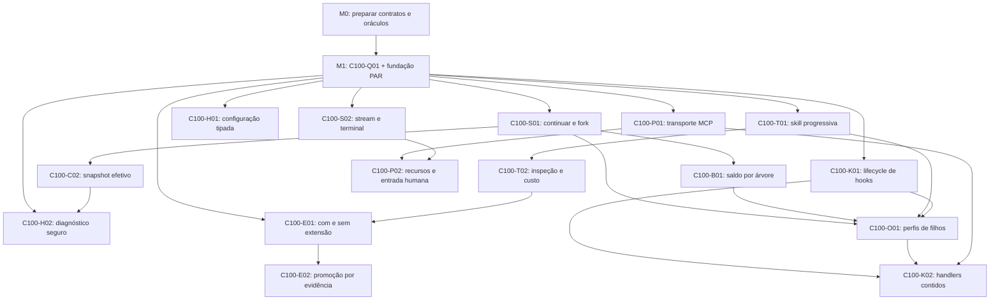

# 0394 — Roadmap de incorporação das melhorias do Claude Code

Task `REA-CLAUDE-PLAN-20261022`, 22/10/2026. Planejamento do recorte das nove oportunidades CC22 do [relatório 0623](../04_audit/0623_claude_code_improvements_2026-10-22.md). [Backlog de execução 0395](0395_backlog_melhorias_claude_rea.md). Estado desta entrega: planejamento documental concluído; implementação depende dos cartões e gates existentes.

## Objetivo e relação com os programas vigentes

Incorporar os resultados úteis observados no Claude: skills mais baratas de descobrir, plugins inspecionáveis, sessão recuperável, configuração reproduzível, streaming, orçamento compartilhado, hooks/MCP governados e promoção por avaliação comparativa. Reusar os mecanismos do harness; nenhum executor, sistema de policy ou avaliador paralelo será criado.

Este é um **recorte de execução**, não um substituto do [roadmap integral 0382](0382_roadmap_paridade_claude_code.md). Os estados dos cartões C100 continuam no [0383](0383_backlog_paridade_claude_code.md); os PAR, no [0380](0380_backlog_paridade_100_deepseek.md). O0395 detalha as mesmas identidades e acrescenta o trabalho específico da incorporação. Não mantém uma segunda fila de status nem fecha um cartão inteiro por entregar sua fatia.

Referência observada: Claude 2.1.308. Baseline comparativa do programa:2.1.302, preservada. Código inspecionado: main 420b97b3373389f30ac82c4d4078a21b2363fdf9. [Snapshot imutável dos 16 cartões](../04_audit/evidence/REA-CLAUDE-PLAN-20261022/canonical-card-snapshot.json). Na observação, Q01 está IN_PROGRESS e os demais cartões selecionados TODO; conferir novamente antes de execução. O checkout local 3704 e os ledgers antigos não representam automaticamente a fonte publicada.

## Sequência por entregas demonstráveis

| Marco                                          | Entrega para o operador                                                                                               | Cartões existentes                         | Entrada e saída                                                                                                                   |
| ---------------------------------------------- | --------------------------------------------------------------------------------------------------------------------- | ------------------------------------------ | --------------------------------------------------------------------------------------------------------------------------------- |
| M0 — Contratos preparados                      | Escopo das nove melhorias, relação 302/308, oráculos e SPECs concretas                                                | Preparação T1 dos cartões abaixo           | Entrar com 0623/matriz; sair com WHAT/HOW/aceites e donos, sem mudar pin ou declarar BUILD aprovado                               |
| M1 — Fundação comprovada                       | Abrir sessão, READ permitido, WRITE retido, aprovação autenticada e restart sem efeito duplicado                      | C100-Q01 + reusos PAR do 0383              | Exigir prova atual da composição e comparador contra controle incorreto; unidades antigas ou ajuda CLI não fecham M1              |
| M2 — Skills e plugins inspecionáveis           | Ver origem/hash, requisitos, risco e custo permanente/invocação; carregar corpo apenas na seleção autorizada          | C100-T01 → C100-T02                        | Depois de M1 e dos reusos/gates; SI01–SI12 e negativos passam no boundary público, sem ativação pela inspeção                     |
| M3 — Continuidade e operação reproduzíveis     | Retomar/forkar com contexto correto, explicar configuração e controlar custo agregado após restart                    | C100-S01 → C100-C02/B01; C100-H01/H02      | Depois de M1; logs/snapshots/usage persistidos e isolamento por tenant demonstrados; fork não reutiliza approval                  |
| M4 — Resposta incremental confiável            | Receber parciais, lifecycle e resultado terminal; reconectar ou cancelar com buffers limitados                        | C100-S02                                   | Depois de M1 e do contrato de eventos; um terminal por execução, sem parcial tratada como resposta final                          |
| M5 — Ferramentas e hooks governados            | MCP sintético, hooks com origem/prazo e perfis de filhos sob o mesmo kernel                                           | C100-P01/P02/K01/O01/K02                   | P02 espera S02; O01 espera S01/B01/T01/K01; K02 espera K01/O01/P01. Discovery e hooks não concedem autoridade                     |
| M6 — Benefício medido e integração qualificada | Relatório com/sem extensão, custo/qualidade/latência e recibos vinculados à versão; demonstração integrada do recorte | C100-E01 → C100-E02 + gates de cada cartão | E01 pode começar assim que T02/Q01 estiverem qualificados; sair com provas atuais do recorte, sem anunciar 134 aceites ou release |

M2, M3 e M4 podem avançar em paralelo **depois de M1**, com fronteiras/claims disjuntos. M6 não precisa aguardar toda M5 para iniciar a avaliação de um plugin pronto. Pesquisa e preparação documental M0 podem ocorrer agora; implementação de um cartão espera suas dependências exatas, SPEC e autoridade. As fases são uma leitura do fluxo, não novas barreiras artificiais.

O desenho inclui as dependências C100 diretas do recorte; os reusos PAR completos estão nas fichas 0395/0383. Por exemplo, a seta Q01→T01 não elimina PAR-T07/C06/K05. Q01 tem dependência G04 e reusos próprios. O grafo completo C100 consultado, incluindo pré-requisitos, é acíclico; isso não significa que as dependências já estejam concluídas.

## Primeira entrega recomendada

**Agora, documental:** consolidar o [contrato de inspeção offline](../04_audit/evidence/REA-CLAUDE-20261022/skill-preflight-proposal.md) numa SPEC concreta do owner C100-T01/T02. Definir perfis de inventário/admissão, campos, limites, redigido de segredos, estimador versionado e SI01–SI12. Reconciliar o delta 308 sem mover o pin 302. Essa preparação não espera nova execução de modelo ou canal.

**Primeiro BUILD de valor visível, quando os pré-requisitos forem atendidos:** inventário de skill/plugin com custo de contexto e aquisição seletiva do corpo. Deve preservar o manifesto JSON strict e o grant existentes. A constatação do Claude — custo permanente estimado 17 tokens, invocação até 1,5 mil no corpo maior — fundamenta a separação das métricas, não uma meta universal de tokens para o CVG.

**Fundação anterior obrigatória:** revalidar o fechamento real de Q01/M1 e reusos integrados. O trabalho já qualificado no programa é reaproveitado com seus receipts e identidade; não relançar todo o programa nem assumir que unidades locais antigas fecharam os pais.

## Responsabilidades e paralelismo

| Dono de função do programa | Frente                                                     | Fronteiras e coordenação                                                                             |
| -------------------------- | ---------------------------------------------------------- | ---------------------------------------------------------------------------------------------------- |
| Integrador Claude100       | Composição, versões, gates e recibos                       | Um writer dos contratos e do estado canônico; conciliar implementações em candidata própria          |
| L1                         | Sessões, snapshots e budget durável                        | Reserva e identidade de sessão/árvore definidas antes de clientes/subagentes dependentes             |
| L2                         | API/SDK/CLI, configuração, diagnóstico e stream            | Não confundir transporte JSON com streaming de geração; versionar interfaces                         |
| L3                         | Skills/plugins, MCP e hooks                                | Registry, grant e egress canônicos; paths compartilhados sequenciados                                |
| L4                         | Perfis de subagentes para os handlers que precisarem deles | Interseção de grants, linhagem e cancelamento; sem supervisor concorrente                            |
| L5                         | Comparador, evals, medição e revisão                       | Fixtures independentes e controle conhecido como incorreto; não aceitar plugin por sua própria suíte |

São funções existentes do 0383, não novas pessoas designadas. Confirmar o agente responsável e o claim antes de editar. L1/L2/L3 podem preparar contratos em paralelo; arquivos/DB/ports/gerados comuns precisam de owner único ou execução sequencial.

## Gates e definição de pronto

- T1: planejamento, recon e SPEC proposta podem ser preparados com fontes/links/formatação/evidência. Esta rodada entrega somente isso.
- T3: contratos públicos, parsing, configuração, persistência, identidade ou autoridade exigem SPEC revisada pelo usuário antes do BUILD, além das verificações T2. Aprovação anterior de outra SPEC não é reaproveitada por associação.
- T4: provider/canal/dado real, efeito externo sensível ou release candidate requerem pacote/candidato hash-bound e decisão específica. Nada neste recorte autoriza produção, publicação externa ou uso clínico por modelo.
- Implementação: prova positiva e negativa no boundary público, revisão independente, typecheck/lint/unitários e PG/E2E aplicáveis em Node 22; certificação ao final da rodada com código/candidato conforme constituição e claim próprio. `NOT_RUN`, `INCOMPLETE`, ajuda CLI ou fonte estática não contam como comportamento aprovado.

Uma fatia fecha quando sua demonstração e seus aceites têm evidência atual da mesma composição, sem falhas obrigatórias. Isso não fecha o cartão pai se houver aceites fora do recorte. A conclusão das nove oportunidades tampouco representa 100% Claude100, 17 controles CVG, aceite B6 ou produção do Assistente de Plantão; esses programas preservam suas barras.

## Horizonte e medição

Ordem operacional: M0 agora; M1 antes de novas capacidades; M2/M3/M4 em frentes disjuntas; M5 conforme dependências; M6 avalia assim que houver uma extensão pronta e termina com a integração demonstrada. Não há datas fixas sem conferir o saldo já integrado dos PAR e a capacidade dos donos.

As ROM do 0383 são dos **cartões completos**, incluindo trabalho fora deste recorte. Não somá-las como orçamento novo nem transportar a estimativa de 8–15 dias da auditoria 0622: aquela se referia a um candidato ao piloto de produção, não a estas melhorias. Após o recon de M0, cada SPEC estima seu delta remanescente; evitar contar reuso duas vezes.

Medir por resultado: nove oportunidades com todos os aceites do recorte comprovados, erros conhecidos rejeitados, quantidade/qualidade do contexto no resume, proporção de streams com terminal correto, teto agregado sob concorrência e delta de qualidade/custo/latência das extensões. Mostrar sempre o denominador e as limitações, sem converter marcos em porcentagem arbitrária.

## Continuidade

[Evidências do planejamento](../04_audit/evidence/REA-CLAUDE-PLAN-20261022/verification.json) registram rastreabilidade/grafo/links/formato, não testes de implementação. [Handoff](../08_runtime/handoffs/rea_claude_plan_20261022.md) contém entradas prontas para os ledgers premodificados, preservando os writers concorrentes.

Próxima ação única: preparar a SPEC da inspeção offline a partir de SI01–SI12, com vínculo a C100-T01/T02, recon dos reusos e gate explícito antes de código. O0395 é o índice das demais entregas e de seus pré-requisitos.
