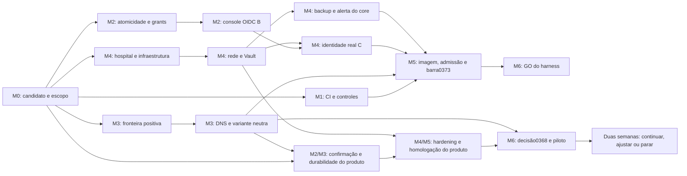

# 0398 — Roadmap até produção interna e piloto do consumidor

Data: 23/10/2026. Task `PROD-PLAN-0624-20261023`. Direção e premissas no [plano executivo0397](0397_plano_executivo_producao_aud0624.md); tasks detalhadas no [backlog0399](0399_backlog_producao_aud0624.md). Snapshot de planejamento9a56a9c9; não altera status das carteiras canônicas.

## 1. Marcos por demonstração

| Marco                                   | Entrega observável                                                                                                      | Unidades                      | Saída necessária                                                                 | Janela indicativa                                             |
| --------------------------------------- | ----------------------------------------------------------------------------------------------------------------------- | ----------------------------- | -------------------------------------------------------------------------------- | ------------------------------------------------------------- |
| M0 — Saber o que será liberado          | Candidato, escopo, donos e decisões existentes reconciliados                                                            | U01                           | G0: mapa por artefato; entregas antigas não reaparecem como trabalho novo        | Início,0,5–1dia                                               |
| M1 — Qualificar a fábrica de evidências | CI completa e controles de publicação com oráculos válidos                                                              | U02                           | G1/recibos: nenhuma aprovação por wait, skip indevido ou certificado de outroSHA | Começa no início; pode exigir o novo candidato após correções |
| M2 — Tornar o fluxo central correto     | Criação/audit e grants consistentes; login de console sintético em hosts distintos; preview do produto ligado à revisão | U03/U04/U08 e U18             | G2 funcional: positivos e negativos públicos demonstrados, sem efeito indevido   | Faixa de semanas1–3, conforme contratos/claims                |
| M3 — Provar independência e recuperação | Fronteira positiva, DNS cancelável, variante neutra; durabilidade/pausa do produto                                      | U05/U06/U07 e U19/U20         | G2 do core: HISO014 aceito; saldo do produto provado no seu escopo               | Faixa de semanas1–4; reestimar U05 após2dias de recon         |
| M4 — Preparar o destino                 | Servidor, egress, Vault, identidade real, monitor/backup; hardening próprio do produto                                  | U09/U10/U11/U12/U13/U14 e U21 | G3 operacional: ensaios no ambiente autorizado e receptor real, por artefato     | Infra começa no início; conclusão depende do hospital         |
| M5 — Qualificar a composição            | Imagem verificável/rollback, dez condições0373 e homologação do produto                                                 | U15/U16 e U22                 | Pacotes de decisão atuais; falha reabre a prova afetada                          | Faixa condicional de semanas4–8                               |
| M6 — Decidir e acompanhar o uso         | GO do harness e, separadamente, piloto autorizado do Assistente                                                         | U17 e U23                     | GH e GP distintos; decisão final do piloto com dados de duas semanas             | Só após gates; piloto acrescenta duas semanas                 |
| M7 — Melhorar manutenção                | Primeira extração de responsabilidade com contratos preservados                                                         | U24                           | Novo candidato/gates próprios; não alterar oRC do piloto                         | Depois da estabilização; não bloqueia primeira entrada        |

As janelas não são datas contratadas. Não pressupõem servidor comprado, IdP escolhido, acessos ou decisões humanas já concluídos. Esforços por unidade e capacidade estão no0397; não somar a duração do piloto aos dias-pessoa como se fosse implementação contínua.

## 2. Ordem e trabalho paralelo

O desenho resume frentes; a dependência executável exata está nas24 fichas U01–U24. Em especial, o produto precisa de infraestrutura própria/compartilhada qualificada e HISO014, mas não recebe a dependência artificial de GH/identidade da API. Monitor/restore do produto já existentes não devem ser reimplementados esperando o monitor novo do núcleo.

| Pode avançar em paralelo                                               | Condição de coordenação                                                                         |
| ---------------------------------------------------------------------- | ----------------------------------------------------------------------------------------------- |
| Preparação de atomicidade, recon da fronteira e inventário do hospital | Paths e responsáveis separados; nenhuma implementação antes do gate da fatia                    |
| Isolamento/analisador e desenvolvimento do produto                     | Não editar simultaneamente manifests/lock/shared adapters; um integrador para fronteiras comuns |
| Infraestrutura e fatiaB de console                                     | A fatiaB usa hosts HTTPS sintéticos; produção/IdP real continua na fatiaC                       |
| Homologação/guia e prova0373                                           | Artefatos e dados próprios; não promover resultados de um para o outro                          |
| Acompanhamento do CI atual e preparação dos próximos deltas            | Reusar holder0396 e registrar o SHA exato; não disparar certificações concorrentes              |

## 3. Dependências que não podem ser abreviadas

- U03→U04→U08→U09: alteração de contrato/identidade é revisada por fatia. A implementação0254-A é prévia, não trabalho novo.
- U05→U06→U07: esta projeção conserva HISO011 e o aceite de independência; preparação T1 pode anteceder. BUILD antecipado só se uma autoridade existente cobrir expressamente a fatia independente.
- U10→U12→U09/U13/U14: ambiente e mecanismos de segredo/recuperação precisam existir antes de ensaio real. O plano não concede acesso nem gera segredos.
- U15→U16→U17: imagem verificável e operação integram o mesmo candidato; a decisão só chega depois do pacote concreto.
- PISO004→PISO003→PISO005 dentro de U19: writer/journal duráveis vêm antes de tratar retries de entrega e ticks concorrentes.
- U18→U19→U20→U21→U22→U23, mais HISO014: não há piloto para compensar confirmação, recuperação ou homologação faltantes.

As dependências completas dos pais continuam nas carteiras0367/0370/PISO. O grafo local é acíclico e ajuda a ordenar este recorte; não significa que todos os pais estejam READY ou encerrados. O [grafo validado](../04_audit/evidence/PROD-PLAN-0624-20261023/dependency-analysis.json) registra esse limite.

## 4. Quadro dos primeiros passos

| Ordem | Trabalho imediato                                                          | Resultado da janela                                                |
| ----- | -------------------------------------------------------------------------- | ------------------------------------------------------------------ |
| 1     | U01: conferir publicação/candidato, decisões, claims e matriz por artefato | Saldo verdadeiro; nada reimplementado porque o checkout está atrás |
| 2a    | U03: contrato e sondas de criação+audit                                    | SPEC curta com rollback/retry/crash e fronteiras memória/PG        |
| 2b    | U05: recon limitado do perfil/WORKSPACE-MAP/0246                           | Proposta finita e reestimativa; INCOMPLETE continua explícito      |
| 2c    | U10: inventário com TI                                                     | O que está disponível, o que depende de aquisição e quem responde  |
| 2d    | U02: acompanhar barra e0396 pelo holder                                    | Resultado atual ou falha discriminada, sem duplicar patch300min    |
| 3     | U04/U08/U18: preparar as próximas fatias nos caminhos livres               | Claims e gates específicos, sem autorizar BUILD só pelo roadmap    |

## 5. Replanejamento e retomada

A cada marco, o integrador registra candidato, entregas, evidências e a próxima unidade concreta no cartão pai e nos ledgers disponíveis. Ao retomar, confere remote/claims/gates antes de executar uma ação antiga. Mudança em identidade, schema, perfil de fonte/prova, provider ou efeito externo reabre o contrato correspondente; mudança documental não invalida automaticamente um gate hash-bound que não a usa.

Replanejar o calendário quando U05 revelar nova classe semântica ou quando U10 apontar infraestrutura indisponível. Não absorver a espera em uma porcentagem de progresso. NO_GO permanece enquanto houver condição obrigatória sem prova, e uma decisão negativa recebe um próximo passo verificável em vez de um pedido genérico de aprovação.
