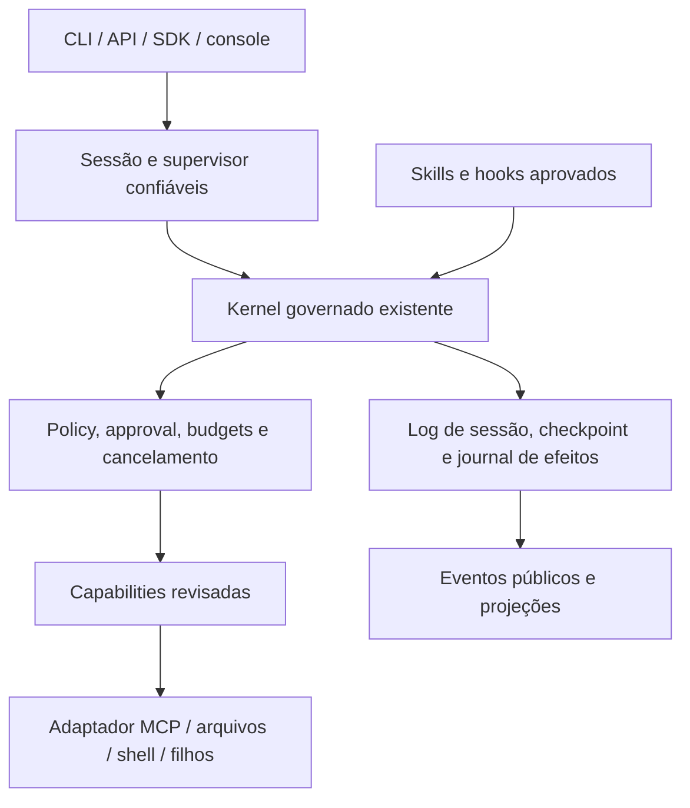

# 0618 — Claude Code: capacidades aproveitáveis no Operational Harness

Data: 17/10/2026. Task `REA-CLAUDE-20261017`, Codex. T1 documental: análise do harness e investigação de oportunidades com o MCP REA. Baseline `7ecc5b53944dcbc50fc26a95cfaec05bb1c62eb5`. Nenhuma implementação ou decisão de release nesta rodada.

## Parecer

**O melhor aproveitamento do Claude Code é completar as superfícies de operação do harness sobre o kernel governado existente.** As prioridades recomendadas são MCP governado, continuidade de sessões, streaming, contexto que preserve obrigações e subagentes com autoridade limitada. Hooks configuráveis, skills verificáveis e avaliações comparativas completam esse conjunto.

O harness já tem execução iterativa, políticas, approvals, journal de efeitos, checkpoints, eventos de sessão, compactação, plugins, SDK, orçamento e sandbox. Portanto, esses conceitos não devem ser apresentados como funcionalidades inteiramente ausentes. O ganho está em integração, persistência, descoberta, ergonomia e provas nas fronteiras públicas.

O plano de paridade [0379](../03_build/0379_roadmap_paridade_100_deepseek.md) e o [backlog 0380](../03_build/0380_backlog_paridade_100_deepseek.md) já contemplam grande parte das oportunidades. Esta análise acrescenta origem e critérios propostos; não cria uma segunda carteira de implementação, não altera prioridades aprovadas e não recalcula os 266 itens de paridade DeepSeek usando o Claude como denominador.

## Método, identidade e limites

O pedido foi dividido em quatro perguntas: como o harness funciona hoje; quais capacidades o programa instalado expõe; onde existem equivalentes ou lacunas; quais adaptações têm valor sem violar a ADR-010.

O REA abriu o executável `/home/ricardo/.local/share/claude/versions/2.1.302`: ELF x86-64, SHA-256 `60d7eb7f12fbb28a52533fe8be5884097403562aa02dc73991a021c7067e29a5`. A captura de `--version` confirmou `2.1.302 (Claude Code)`. Foram executadas **oito capturas informativas, todas com exit 0**: ajuda principal, versão, ajuda de agents, mcp, plugin, gateway, plugin eval e mcp add. Comandos, identidade amostrada do executável e limitações estão no [índice de evidências](evidence/REA-CLAUDE-20261017/inspection.json); o [bundle original do REA](evidence/REA-CLAUDE-20261017/rea-evidence-bundle.json) preserva os registros completos.

Essas capturas comprovam a superfície anunciada pelo programa, **não a execução funcional de cada recurso**. Não foram iniciados agentes, servidores MCP, avaliações com modelo, sessões cloud ou plugins. `HOME` e `CLAUDE_CONFIG_DIR` apontaram para diretórios temporários próprios, com flags para desativar atualização e tráfego não essencial. O REA herda outras variáveis do ambiente: isso não prova isolamento completo. Rede e efeitos de filesystem não foram observados; não se afirma ausência de tráfego ou de escrita fora dos caminhos temporários. Não houve leitura intencional de credenciais ou transcrições pessoais.

`binary_overview` retornou `provider_unavailable`: Ghidra não configurado, Hopper ausente e IDA não configurado. Não houve descompilação nativa nem recuperação de código-fonte interno. A inspeção ELF auxiliar por `readelf` observou seções `.bun` e `.bun_builtins`; isso não recupera a lógica do produto. O MCP permaneceu utilizável para captura de processos.

A documentação oficial foi consultada para explicar hooks, subagentes, skills, memória, checkpointing e sandbox. Ela descreve a documentação disponível na consulta, sem garantir que cada detalhe corresponda à versão instalada. Cada conclusão distingue:

- **CLI observada:** texto emitido pelo executável em captura REA.
- **Documentado:** comportamento descrito pela Anthropic, sem replay funcional nesta rodada.
- **Código observado:** estrutura e implementações lidas no checkout do harness, sem nova execução de seus testes.
- **Proposto:** adaptação, prioridade e aceite sugeridos pelo analista.

## Análise do harness atual

| Área                    | Evidência no checkout                                                                                                                                                                                                                               | Consequência para a comparação                                                                                                                                  |
| ----------------------- | --------------------------------------------------------------------------------------------------------------------------------------------------------------------------------------------------------------------------------------------------- | --------------------------------------------------------------------------------------------------------------------------------------------------------------- |
| Composição e loop       | [createOperationalHarness](../../packages/harness/src/createOperationalHarness.ts) seleciona `single_pass` ou `iterative`; o iterativo exige orchestrator e step-store.                                                                             | Já existe motor de agente; um supervisor não deve criar outro loop que contorne o kernel.                                                                       |
| Controle de ferramentas | [pipeline](../../packages/harness/src/kernel/pipeline.ts) centraliza log, gates, guards, contenção, cancelamento e settlement; [host](../../packages/harness/src/kernel/host.ts) ordena controles antes de capabilities e sela registros após boot. | Preservar policy/approval e validação de efeito em toda nova ferramenta, hook ou filho.                                                                         |
| Efeitos e retomada      | [effect-journal](../../packages/harness/src/effect-journal.ts), [step-store](../../packages/harness/src/step-store.ts) e [execution-spine](../../packages/harness/src/execution-spine.ts) fornecem seams de deduplicação e checkpoints.             | Checkpoint de execução não equivale a fork de conversa, supervisor durável ou undo de filesystem.                                                               |
| Sessões                 | [contratos](../../packages/contracts/src/session-events.ts), [store PostgreSQL](../../packages/persistence/src/session-events.ts), [log do kernel](../../packages/harness/src/session/kernel-log.ts) e SDK oferecem bases.                          | Existência de armazenamento de eventos não comprova a API pública completa de ciclo de vida entre processos.                                                    |
| Contexto                | [context-engine](../../packages/harness/src/context-engine.ts) prioriza itens; [compaction](../../packages/harness/src/compaction.ts) usa estimativa de quatro caracteres/token e resumo determinístico com padrão de 512 caracteres.               | Há compactação; falta provar preservação semântica de obrigações em histórico longo e tratamento de overflow conforme PAR-C01/C02.                              |
| Extensibilidade         | [PluginRegistry/CapabilityGateway](../../packages/platform/src/plugin-gateway.ts), [event-bus](../../packages/platform/src/event-bus.ts) e [loader de skills](../../packages/harness/src/skills/loader.ts) já existem.                              | Event listeners e manifests `skill.json` não equivalem ao ciclo inteiro de hooks configuráveis e skills progressivas do Claude.                                 |
| Integração programática | [protocolo SDK](../../packages/sdk/src/protocol.ts), [stdio](../../packages/sdk/src/stdio.ts) e SDK Python implementam uma superfície própria.                                                                                                      | JSON-RPC sobre stdio não é automaticamente MCP, nem streaming de tokens ou JSON Schema de saída do modelo.                                                      |
| Modelos e custo         | [router](../../packages/model-gateway/src/router.ts), [retry](../../packages/model-gateway/src/retry.ts) e [budget](../../packages/model-gateway/src/budget.ts) implementam fallback condicionado, backoff e limites por escopo.                    | Aprimorar exposição e agregação; não recriar roteamento e budget. O store em memória mostrado nesse módulo não prova limite global persistente entre processos. |
| Streaming               | Providers [OpenAI compatible](../../packages/model-gateway/src/providers/openai-compatible.ts) e [Ollama](../../packages/model-gateway/src/providers/ollama.ts) enviam `stream: false`.                                                             | Lacuna concreta para saída incremental de modelo; leitura paginada de eventos não a resolve.                                                                    |
| Contenção               | [gate](../../packages/sandbox/src/gate.ts) e [runContained](../../packages/sandbox/src/run.ts) usam handles e bubblewrap, com falha fechada na indisponibilidade.                                                                                   | Sandbox já existe; precisa das provas e limites previstos em PAR-X01–X03. Worktree não substitui contenção.                                                     |

Um cuidado de nomenclatura: [controlled-kernel-delegation.test.ts](../../packages/platform/src/__tests__/controlled-kernel-delegation.test.ts) verifica a delegação da plataforma ao kernel. Isso **não demonstra subagentes pai/filho** com spawn, mailbox e grants herdados. A comparação foi feita pelo caminho chamado e seus contratos, não pelo nome do teste.

Quanto à operação, a análise [0617](0617_harness_operational_state_2026-10-17.md) registra núcleo funcional em testes e candidata estável `5a199668` com certificação local condicionada anterior, distinta deste checkout e do PARE100. Produção e aceite formal de isolamento continuam pendentes. Esses resultados são atribuídos à rodada anterior; não foram reexecutados aqui. Nenhuma capacidade nova do Claude resolve, por si, B6, CI no SHA candidato ou C1–C10 no servidor.

## Funcionalidades extraídas e destino recomendado

Prioridades abaixo são recomendações desta análise, sem reordenar o plano aprovado. Os IDs CC18 identificam observações, não novos cartões executáveis. A [matriz estruturada](evidence/REA-CLAUDE-20261017/capability-matrix.json) contém aceites propostos e referências de evidência.

| ID      | Capacidade do Claude Code e base da observação                                                        | Estado comparável no harness                                                                  | Adaptação recomendada / carteira existente                                                                                                                                        | Prioridade sugerida               |
| ------- | ----------------------------------------------------------------------------------------------------- | --------------------------------------------------------------------------------------------- | --------------------------------------------------------------------------------------------------------------------------------------------------------------------------------- | --------------------------------- |
| CC18-01 | Hooks por evento; CLI menciona hooks e stream de eventos; semântica na documentação.                  | Hooks do kernel e event-bus existem; configuração externa não equivale a listeners em código. | Protocolo declarativo que só restringe ou anexa contexto, com timeout, origem e audit. PAR-K09; ponte Claude/Codex em PAR-K10 depois.                                             | P1                                |
| CC18-02 | Subagentes especializados; `--agents` e `--agent`; documentação detalha contextos próprios.           | Motor e budgets existem; supervisor pai/filho não localizado na superfície examinada.         | Filho no mesmo kernel, grants por interseção, budget reservado e linhagem. PAR-O01/O02, K06 e S04.                                                                                | P1                                |
| CC18-03 | `--continue`, `--resume`, `--fork-session`, `--session-id`.                                           | Eventos e retomada de execução existem; fork público completo não demonstrado.                | Sessão durável, consulta e fork com nova identidade de aprovação. PAR-S01/S02/S04/S05.                                                                                            | P1                                |
| CC18-04 | `mcp add`: stdio/HTTP/SSE, escopos e OAuth; `--strict-mcp-config`.                                    | SDK próprio e capabilities existem; cliente MCP genérico não localizado.                      | Adaptador MCP governado, discovery revisada, schemas e efeito explícito, secrets por servidor. PAR-P01, X02 e T12.                                                                | P1                                |
| CC18-05 | Skills e plugins; `plugin validate`, `details`, `--plugin-dir`; carregamento progressivo documentado. | Loader `skill.json`, catálogo e registry presentes.                                           | Manifesto com origem/hash, catálogo de descrições e carregamento do corpo sob demanda; dependências e custo visíveis. PAR-T07, K04 e H04.                                         | P1                                |
| CC18-06 | `--autocompact`; memória de projeto e regras por escopo documentadas.                                 | Compactação heurística presente; store de eventos não é memória aprendida.                    | Preservar obrigações, aprovações e fontes estruturadas; instruções por origem e validade; memória revisável e isolada. PAR-C01/C02/C03/C05/C06.                                   | P1 para contexto; P2 para memória |
| CC18-07 | `--print`, `stream-json`, `--json-schema`, mensagens parciais e replay de entrada.                    | SDK JSON-RPC/stdio existe; providers sem streaming de tokens.                                 | Contrato incremental versionado, cursor, cancelamento e um resultado terminal; validação da saída separada de autorização. PAR-M01, A01, H01.                                     | P1                                |
| CC18-08 | `--permission-mode plan`, tools permitidas/negadas, modo restricted.                                  | Policies/approvals e perfis existem.                                                          | Perfil de planejamento com grants realmente somente leitura e plano versionado, mantendo gate para execução. PAR-K05 e O09.                                                       | P2                                |
| CC18-09 | `--restricted`; isolamento de Bash por SO documentado.                                                | Sandbox com bubblewrap e handles existe.                                                      | Explicitar matriz de capacidades do host e provar egress, paths, recursos e falha fechada. PAR-X01/X02/X03.                                                                       | P1                                |
| CC18-10 | `--max-budget-usd`, `--effort`, `--model`, `--fallback-model`.                                        | Budget, router e retries já implementados.                                                    | Expor limites e decisões; custo agregado dos filhos e fallback sem mudar classificação/localidade silenciosamente. PAR-K05/O01/H02; extensão de budget a especificar.             | P2                                |
| CC18-11 | `--background`, `agents`, `attach`, `logs`, `stop`, `respawn`.                                        | Worker/outbox existentes; supervisor por sessão não demonstrado.                              | Jobs com dono, eventos, stop e recuperação, conservando ledger de efeitos. PAR-O03/O02/A04.                                                                                       | P2 após sessões                   |
| CC18-12 | `--worktree`, `--add-dir`, `--tmux`.                                                                  | Workspace base do sandbox existe; isolamento de desenvolvimento é coordenação externa.        | Registro por tenant e workspace descartável por tarefa; worktree como adapter opcional para coding. PAR-T09; worktree exige extensão de escopo.                                   | P2                                |
| CC18-13 | Rewind de código/conversa documentado.                                                                | Checkpoint de execução existe; undo de arquivos não localizado.                               | Fork e simulação/replay primeiro; snapshot/restore apenas de artefatos próprios, com conflito detectado. PAR-S04 cobre fork, não todo o undo.                                     | P3 para undo                      |
| CC18-14 | `--settings`, `--setting-sources`, `--safe-mode`, `--bare`, snapshot do system prompt.                | Configuração/prompt e fingerprint existem.                                                    | Dump redigido com origem/precedência, configuração efetiva congelada por execução e modo diagnóstico que mantém controles. PAR-H02/K05/M02.                                       | P2                                |
| CC18-15 | `plugin eval`: baseline com/sem plugin, mocks, custo e threshold.                                     | Evals e test-lab existem.                                                                     | Comparar benefício, custo e regressão de cada skill/plugin contra baseline sintética; independente do aceite de segurança. PAR-Q03/Q04/Q06 e T07; ablação como extensão proposta. | P1                                |
| CC18-16 | CLI anuncia cloud, remote-control, IDE e gateway corporativo.                                         | API/worker/console e governança próprios existem.                                             | Estudar adapters após estabilidade; gateway anunciado não prova controles internos. PAR-P03/P04 e H01/U01 cobrem partes, sem equivalência integral.                               | P3                                |

Fontes oficiais para a interpretação: [hooks](https://code.claude.com/docs/en/hooks), [subagentes](https://code.claude.com/docs/en/sub-agents), [MCP](https://code.claude.com/docs/en/mcp), [skills](https://code.claude.com/docs/en/skills), [plugins](https://code.claude.com/docs/en/plugins), [memória](https://code.claude.com/docs/en/memory), [execução programática](https://code.claude.com/docs/en/headless), [sandbox](https://code.claude.com/docs/en/sandboxing), [checkpointing](https://code.claude.com/docs/en/checkpointing), [configuração](https://code.claude.com/docs/en/settings) e [CLI](https://code.claude.com/docs/en/cli-reference). A matriz relaciona cada oportunidade à sua fonte específica.

## O que incorporar primeiro e como provar valor

### 1. MCP como adaptador de capabilities

É a oportunidade de maior alcance para conectar ferramentas sem criar adapters específicos para cada aplicação. O Claude instalado anuncia gestão de servidores, transportes e aprovação por projeto. A [documentação MCP](https://code.claude.com/docs/en/mcp) descreve a integração; nesta rodada não houve conexão a servidor pelo Claude.

No harness, discovery não deve conceder autoridade: cada ferramenta descoberta precisa de schema, classificação de efeito, escopo e versão aprovados antes de virar capability. Saídas de servidores entram como dados não confiáveis. HTTP requer as proteções de rede/SSRF; stdio exige posse e limpeza do subprocesso.

**Aceite proposto:** servidor sintético oferece ferramenta READ e WRITE; READ segue grant, WRITE para em approval; ferramenta nova não aprovada é recusada; mudança de schema invalida a composição; cancelamento não deixa filho órfão nem transforma efeito incerto em sucesso. Usar PAR-P01 e suas dependências, sem converter `serveStdioSdk` em um suposto cliente MCP.

### 2. Sessões continuáveis antes de ampliar autonomia

Retomar e bifurcar trabalho tem mais valor operacional quando histórico, pendências e autoridade são reproduzíveis após restart. Reutilizar contratos de eventos, step-store e journal, mantendo distinta a identidade da conversa, da execução e da aprovação.

**Aceite proposto:** abrir sessão sintética num processo, parar e continuar em outro; o histórico e a aprovação pendente permanecem; retry não duplica efeito; fork recebe nova linhagem e não reutiliza aprovação do original; acesso por outro tenant é negado. PAR-S01/S04/S05 são o destino, observando os ajustes humanos já registrados para a SPEC0221.

### 3. Streaming e saída estruturada no contrato público

A ajuda observada expõe saída incremental e schema de resultado; a [documentação programática](https://code.claude.com/docs/en/headless) explica sua integração. No harness, eventos de sessão já oferecem uma base, mas não substituem tokens incrementais do provider.

**Aceite proposto:** modelo sintético gera chunks; API/SDK preservam correlação e ordem; cliente reconecta por cursor sem repetir eventos; cancelamento chega ao provider; corte de stream gera erro terminal e nunca uma resposta parcial marcada como final. Validar JSON do resultado não autoriza executar seu conteúdo. PAR-M01/A01 primeiro; schema de resposta precisa de contrato próprio na SPEC.

### 4. Contexto e memória com proveniência

A [memória do Claude](https://code.claude.com/docs/en/memory) distingue instruções mantidas pelo usuário e aprendizados persistidos. Esse padrão é útil para reduzir releitura, mas o harness precisa controlar origem, tenant, versão, validade e revisão. Um aprendizado não pode virar fonte institucional aprovada nem autorização.

A compactação atual usa excertos curtos: convém proteger fatos e obrigações estruturados e tratar o resumo como derivado. **Aceite proposto:** histórico sintético longo mantém approval pendente, bloqueio, fonte e próxima ação após compactação; cancelamento não publica resumo; nota expirada ou de outro tenant não é carregada; instrução aprendida não sobrepõe policy. PAR-C01/C02/C06 cobrem partes; memória aprendida exige Discovery/PRD próprios, pois não está integralmente definida nesses cartões.

### 5. Subagentes com limites herdados e supervisor

Os [subagentes documentados](https://code.claude.com/docs/en/sub-agents) trabalham com contexto e ferramentas próprios. Esse padrão permite explorar/revisar sem inflar a sessão principal. Sessão em segundo plano e subagente são mecanismos diferentes; a presença de `claude agents` não demonstra, por si, isolamento de contexto de um filho.

**Aceite proposto:** revisor sintético recebe somente leitura, não escreve apesar de solicitado; filho nunca amplia tenant, grants ou teto agregado; cancelamento do pai alcança filhos; relatório do filho é dado, não approval; audit registra pai, filho, budget e conclusão real. PAR-O01/O02 dependem da continuidade e steering já planejados; um processo separado sozinho não oferece essas garantias.

### 6. Hooks e skills sobre as fronteiras atuais

Os [hooks documentados](https://code.claude.com/docs/en/hooks) permitem observar e restringir ações em pontos do ciclo; as [skills](https://code.claude.com/docs/en/skills) organizam instruções carregadas conforme uso. O harness já tem pontos de extensão, por isso deve adaptar formato/configuração sem criar uma segunda autoridade de controle.

**Aceite proposto:** hook não consegue liberar uma negação obrigatória; timeout bloqueia a etapa conforme contrato; contexto anexado carrega origem; skill sem hash/grant não entra; catálogo curto é carregado antes do corpo completo. PAR-K09/T07, depois K10 para compatibilidade. Comandos de hook precisam do mesmo serviço de subprocesso e dos mesmos controles de efeito das demais ferramentas.

### 7. Avaliações com e sem extensão

A captura de `plugin eval --help` anunciou ablação com/sem plugin, mocks, limite de custo, threshold e relatório. Esse é um padrão particularmente útil: uma extensão precisa melhorar resultado mensurável, não apenas aumentar o catálogo. O auxílio também explicita que sucesso na suíte não equivale a aprovação de segurança.

**Aceite proposto:** mesma entrada sintética e versão de modelo/perfis nas duas condições; registrar qualidade, violações, custo, latência e estabilidade; mocks como padrão; nenhum servidor real ou script da extensão iniciado implicitamente; regressão de segurança impede promoção mesmo com nota de qualidade maior. Integrar ao test-lab e à qualificação existentes, sem substituir os gates do núcleo. A semântica real do runner do Claude não foi ensaiada.

## Encaixe arquitetural proposto

O diagrama é proposta de encaixe, não descrição de componentes já implementados. Contratos neutros ficam em `packages/contracts`; a fábrica continua compondo portas, sem escolher provider, abrir PostgreSQL ou carregar produto. Hosts/adapters fazem discovery, persistência e transporte. Cada consumidor mantém prompts de domínio, dados e deploy próprios, conforme [ADR-010](../architecture/adrs/ADR-010-harness-product-isolation.md).

Não é necessário tornar Claude Code uma dependência de produção para aproveitar esses padrões. A interoperabilidade com seus formatos deve ser adapter opcional. Backend de modelos continua substituível e sujeito à classificação/localidade dos dados.

## Sequência proposta, sem mudar os gates

| Ordem de trabalho sugerida      | Entrega e dependências                                                                                                                                          | Sinal de conclusão                                                                        |
| ------------------------------- | --------------------------------------------------------------------------------------------------------------------------------------------------------------- | ----------------------------------------------------------------------------------------- |
| A — consolidar fundação         | Concluir as pendências da candidata estável e do isolamento na trilha 0374. Em paralelo documental, reconciliar esta evidência com 0380 e gates 0221/0222/0225. | Identidade e aceite do núcleo claros; oportunidade não é confundida com liberação.        |
| B — continuidade e visibilidade | PAR-S01/S02/S04/S05, M01/A01 e C01/C02, respeitando dependências K03/M02 e decisões vigentes.                                                                   | Sessão sobrevive ao restart; stream termina uma vez; obrigações sobrevivem à compactação. |
| C — extensões governadas        | PAR-X01/X02/X03 e K04 precedem consumidores correspondentes; PAR-P01, K09 e T07 entram com validação e qualificação sintética.                                  | MCP, hook ou skill não amplia autoridade; falha é observável e fechada.                   |
| D — autonomia supervisionada    | K06 e S04 habilitam O01; sessões/API habilitam O03; depois O02/O06 e console.                                                                                   | Filho/job tem dono, budget, cancelamento e recuperação sem duplicação de efeito.          |

Essa sequência explicita dependências, não promete prazo nem substitui os marcos oficiais. Uma SPEC T3 deve definir alterações de contrato, identidade, policy, schema e approval antes de BUILD; T4 aplica-se quando houver efeito externo real, capacidade sensível ou release candidate. A análise atual permanece T1.

Quatro possíveis extensões precisam de definição de produto antes de virar cartões executáveis: memória aprendida, ablação de plugins integrada à promoção, worktree gerenciado para consumidor de coding e undo de arquivos. Os PARs correlatos oferecem partes da solução, não aprovação implícita dessas ampliações.

## Adaptações que não devem ser transpostas literalmente

- Modos de bypass anunciados pelo Claude não devem virar atalho para os controles obrigatórios do harness.
- Um [rewind](https://code.claude.com/docs/en/checkpointing) de conversa/arquivos tem escopo limitado, inclusive para mudanças por shell; não desfaz efeito externo, aprovação consumida ou ação clínica/financeira. Recuperação operacional exige journal, reconciliação e, quando aplicável, compensação autorizada.
- Instalação de plugin, script de avaliação ou configuração MCP não é aprovação de suas ferramentas. Discovery e import precisam produzir uma proposta revisável.
- Memória automática não substitui conhecimento institucional aprovado, nem pertence ao núcleo quando contém domínio de um consumidor.
- Worktree, sandbox e RBAC resolvem fronteiras distintas. O [sandbox de Bash documentado](https://code.claude.com/docs/en/sandboxing) não prova contenção universal de todas as superfícies de uma aplicação.

## Verificação e continuidade

Parecer I0, do próprio analista. Oito comandos informativos passaram; não foram executados testes do harness, certify, PostgreSQL, E2E, chamadas de modelo, deploy ou efeitos reais. Inspeção de código demonstra as implementações lidas, não cobertura funcional completa. Ausências são limitadas aos módulos examinados e às lacunas registradas no 0380; o conteúdo da worktree PARE100 não foi certificado por esta comparação.

Os arquivos de estado/log/backlog já estavam modificados na entrada. A regra 5 de [coordenação](../08_runtime/agent_coordination.md) exige preservá-los; os três deltas estão no [handoff de integração](../08_runtime/handoffs/rea_claude_20261017.md). Esse é trabalho pendente de integração documental, sem alterar status de programas nem repetir pedidos humanos existentes.

**Próxima ação:** reconciliar a matriz CC18 com os cartões canônicos e preparar a fatia de SPEC do PAR-P01 depois de conferir X02/T12 e a autoridade vigente. Para evolução da plataforma, manter sessões/streaming/contexto como fundação paralela; para produção, continuar exclusivamente pela trilha 0374.
