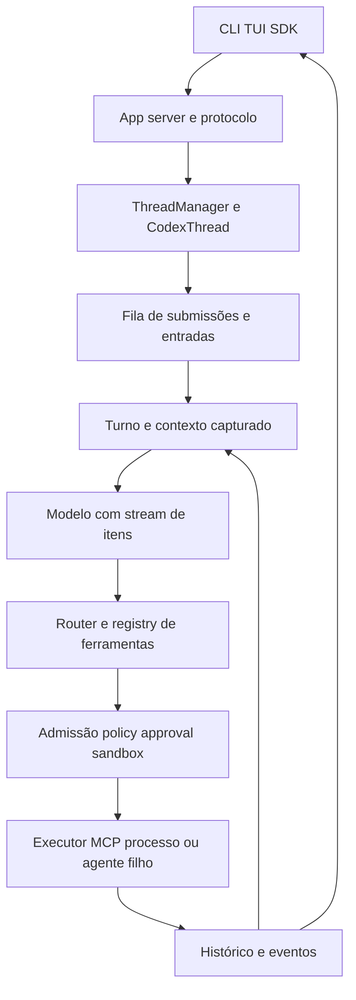

# Núcleo do CVG em comparação com o Codex

O CVG já possui a fundação de um runtime governado. A recomendação é incorporar ao mesmo núcleo o controle de sessões e agentes vivos, a superfície de eventos e o lifecycle operacional que o Codex organiza de forma explícita. O maior trabalho indicado por esta inspeção é integrar e qualificar mecanismos existentes, além de fechar lacunas de interação e supervisão. Não há evidência nesta rodada que justifique substituir o kernel ou reescrever o programa em Rust.

Esta é uma análise arquitetural T1, com leitura estática de fontes e quatro observações da CLI pelo MCP REA. Implementação, equivalência funcional e aceite são estados distintos. Nenhuma alteração de aplicação, execução de modelo, teste de aplicação, certificação ou liberação de produção foi realizada.

## Referências e limites da comparação

- Repositório solicitado: `ricardoakinaga-dev/codex`, main fixada em `a09812981de703f18f38015cd5d500ab373f616c`, commit de01/11/2026. A inspeção é desse fork, sem presumir identidade com a main atual de openai/codex.
- Checkout CVG: `ce23da17fb643a4dd639c175e5ac4aef192dc32a`. Os fontes de aplicação selecionados coincidem com o HEAD; carteiras documentais dirty foram capturadas separadamente.
- Avanços locais inspecionados por `git show`, sem trocar checkout: onda8 `c8be3a516`, onda9 `2a457b6b8` e K06 `2a0c17ae7`. A existência desses fontes não concede integração ou aceite.
- Referência canônica CODEX100: `8d9f6466ff0294785d56f55b1fe363d132fe4133`. Esta investigação não a substitui pelo fork novo.
- CLI local observada: `codex-cli 0.166.0`, SHA-256 `b8a11fedf24b2dfb59a70c9e52b030f9a508dcd49cd2dd0d41956f4c785156b8`. Correspondência com o fork: **UNKNOWN**.

O [manifesto de fontes](04_audit/evidence/CODEX-REA-20261101/source-manifest.json) fixa92snapshots com hashes, revisões e caminhos. As fontes Rust foram lidas diretamente; o REA não forneceu callgraph Rust nesta rodada. A inspeção estática do binário Rust pelo REA foi recusada pelo limite de256MiB do provider; não foi repetida com limites relaxados. A captura de processos funcionou. Não se executou o fork nem se comprovou seu comportamento dinâmico.

## Como o programa organiza as chamadas

No Codex, o launcher Node seleciona o executável da plataforma. A CLI Rust escolhe a superfície interativa, exec ou app-server. No pin inspecionado, `exec` usa um cliente de app-server em processo: o headless é um cliente do runtime. ThreadManager e CodexThread administram sessões, configuração, histórico e estado vivo. As submissões chegam à fila; `submission_loop` despacha operações, interrupção e trabalho pendente. `run_turn` prepara contexto, compacta, solicita inferência e continua quando há resultado de ferramenta ou nova entrada.

O router associa tool call a um runtime; o registry valida e acompanha lifecycle. A admissão distingue chamadas paralelas e exclusivas. Para ferramentas sujeitas a execução/sandbox, ToolOrchestrator coordena aprovação, ambiente, contenção e eventual nova tentativa com a autoridade correspondente. O resultado volta ao histórico/modelo e à superfície de eventos. UnifiedExec gerencia processos persistentes e stdin/polling. AgentControl supervisiona filhos e suas mensagens; shutdown é uma operação com fence, espera e relatório.



No CVG, a entrada API submete uma ExecutionSubmission com tenant/idempotência. O worker faz claim/lease/fencing, compõe `createOperationalHarness` e chama o runtime. A factory escolhe single_pass ou iterative. Os dois perfis usam os controles do kernel; GovernedAgentRuntime conserva fases duráveis e delega a mesma espinha por runtime-kernel-bridge. A plataforma controlada também usa a factory. Há orçamento, cancelamento, policy, approval, sandbox, log e efeito; isso é uma base concreta de reuso.

O pipeline de ferramenta do CVG registra a chamada, executa controles/guards, exige sandbox quando aplicável, persiste o checkpoint pelo hook, revalida a admissão, reserva aprovação, registra início, invoca o corpo, liquida o efeito e fecha o log. O modelo recebe o pedido após controles e tem accounting. O loop iterativo usa decisões JSON e observações em vez de consumir diretamente todos os itens nativos de um stream Codex. As maiores diferenças aparecem acima dessa espinha: sessão viva, protocolo interativo, supervisor de filhos e encerramento observável.

## Matriz de diferenças

As prioridades abaixo são propostas para decisão do integrador, sem alterar prioridade, dependência, dono ou estado dos cartões canônicos. `P0` indica uma fundação de correção/segurança ou prova que bloqueia a jornada; `P1` indica capacidade ou integração principal; `P2` indica ganho de concorrência posterior. Um status de inspeção não é PASS de teste.

| Recorte | Tema                                          | Estado observado                                      | Prioridade proposta | Reuso canônico                                             |
| ------- | --------------------------------------------- | ----------------------------------------------------- | ------------------- | ---------------------------------------------------------- |
| KR01    | Kernel compartilhado e composição entre hosts | EXISTE; PARIDADE ENTRE HOSTS NÃO QUALIFICADA          | P0                  | DX100-K01, PAR-K01                                         |
| KR02    | Loop de decisão e ferramentas nativas         | DIFERENÇA DE ARQUITETURA; IMPACTO NÃO MEDIDO          | P1                  | DX100-K01, DX100-M01, PAR-M01                              |
| KR03    | Pedido efetivo e autoridade capturados        | EXISTE; AVANÇOS EM REVISÃO LOCAL                      | P0                  | DX100-K01, DX100-M01, PAR-M02, PAR-K05                     |
| KR04    | Streaming do provider até o cliente           | INTERNO EXISTE NA ONDA8; PONTA A PONTA ABERTO         | P1                  | DX100-M01, DX100-A03, DX100-D01, PAR-M01                   |
| KR05    | Sessão, retomada e fork                       | BASE PARCIAL; IMPLEMENTAÇÃO REUTILIZÁVEL NA ONDA8     | P0                  | DX100-S01, DX100-S02, PAR-S01, PAR-S04, PAR-K03            |
| KR06    | Agente vivo, steering e cancelamento          | GAP DE INTEGRAÇÃO; K06 EM BUILD                       | P1                  | DX100-K01, DX100-O02, PAR-K06                              |
| KR07    | Supervisor e árvore de subagentes             | NÃO LOCALIZADO NO RECORTE INSPECIONADO                | P1                  | DX100-O01, PAR-O01, PAR-O02                                |
| KR08    | Budget e capacidade por árvore                | CONTROLE POR TURNO EXISTE; CONTRATO DE ÁRVORE ABERTO  | P0                  | DX100-O01, DX100-K01, PAR-O01                              |
| KR09    | Ferramentas paralelas e exclusivas            | SÉRIE NA BASE; DELTA NÃO QUALIFICADO                  | P2                  | DX100-K01, PAR-K07                                         |
| KR10    | Processos persistentes e terminal             | SERVIÇO EXISTE NA ONDA8; PTY PÚBLICO A QUALIFICAR     | P0                  | DX100-X01, DX100-R02, PAR-X01                              |
| KR11    | Política de efeito e sandbox aplicado         | DIFERENÇA MATERIAL; CORREÇÃO JÁ PRESENTE EM CANDIDATA | P0                  | DX100-X02, DX100-X03, PAR-X02, PAR-X03, PAR-X04            |
| KR12    | Aprovação, efeito incerto e handoff           | DIVERGÊNCIA GOVERNADA A PRESERVAR                     | P0                  | DX100-X03, PAR-K03, PAR-X04                                |
| KR13    | Encerramento com relatório de falhas          | DISPARIDADE ESTÁTICA CONFIRMADA                       | P1                  | DX100-K01, DX100-O01, DX100-X01, PAR-K04, PAR-X01          |
| KR14    | Contexto, compactação e saídas grandes        | REUSOS JÁ IMPLEMENTADOS; INTEGRAÇÃO A PROVAR          | P1                  | DX100-C01, DX100-S02, PAR-C01, PAR-C02, PAR-C03, PAR-K03   |
| KR15    | RPC, eventos e requests do servidor           | INCOMPATIBILIDADE DE CONTRATO CONFIRMADA              | P1                  | DX100-A01, DX100-A03, DX100-D01                            |
| KR16    | CLI e configuração operacional                | GAP NA SUPERFÍCIE; SCRIPTS NÃO SÃO CLI EQUIVALENTE    | P1                  | DX100-H01, DX100-H02, DX100-D02, PAR-H01, PAR-H02          |
| KR17    | MCP, hooks e extensões sob controle           | FUNDAÇÃO EXISTE; COMPATIBILIDADE AMPLA PENDENTE       | P1                  | DX100-P01, DX100-E01, DX100-F01, PAR-P01, PAR-K04, PAR-K09 |
| KR18    | Medição de paridade e mudança de referência   | CATÁLOGO EXISTE; NOVO PIN NÃO ADOTADO                 | P0                  | DX100-G01, DX100-G02, DX100-G03, DX100-Q01, DX100-Q02      |

## Achados e critérios para fechamento

### KR01 Kernel compartilhado e composição entre hosts

O CVG tem KernelHost, perfil obrigatório e pipeline comum. SinglePass é fachada; o iterativo e a ponte do GovernedAgentRuntime reutilizam o pipeline. A API enfileira execução e o worker compõe createOperationalHarness. A composição de plataforma controlada também usa a factory.

Preservar essa fundação e qualificar a mesma semântica nos caminhos públicos. No Codex, o exec atual usa InProcessAppServerClient; a centralização inclui protocolo, sessões e lifecycle. Não confundir vários adapters com vários kernels, nem presença de imports com equivalência já provada.

Encaminhamento proposto: L0/L1; DX100-K01, PAR-K01. Critério positivo: A mesma fixture por API, worker e SDK produz decisões, efeitos e causas equivalentes sob regra aprovada. Critério negativo: Uma composição que contorne policy, approval ou journal deve ser rejeitada pelo qualificador. Esses cenários permanecem **NOT_RUN** nesta rodada.

Evidências: [codex-rs/exec/src/lib.rs:1029](04_audit/evidence/CODEX-REA-20261101/source-snapshots/codex-a0981298/codex-rs/exec/src/lib.rs.txt) (codex-a0981298); [codex-rs/core/src/session/handlers.rs:459](04_audit/evidence/CODEX-REA-20261101/source-snapshots/codex-a0981298/codex-rs/core/src/session/handlers.rs.txt) (codex-a0981298); [packages/harness/src/runtime.ts:14](04_audit/evidence/CODEX-REA-20261101/source-snapshots/cvg-ce23da17/packages/harness/src/runtime.ts.txt) (cvg-ce23da17); [packages/agent-runtime/src/runtime-kernel-bridge.ts:34](04_audit/evidence/CODEX-REA-20261101/source-snapshots/cvg-ce23da17/packages/agent-runtime/src/runtime-kernel-bridge.ts.txt) (cvg-ce23da17); [packages/harness/src/execution-spine.ts:1384](04_audit/evidence/CODEX-REA-20261101/source-snapshots/cvg-ce23da17/packages/harness/src/execution-spine.ts.txt) (cvg-ce23da17).

### KR02 Loop de decisão e ferramentas nativas

O HybridOrchestrator aplica regras e, quando necessário, pede um JSON LoopDecision ao modelo; respostas e ferramentas seguem contratos próprios do kernel.

O Codex consome stream de itens/chamadas, despacha ferramentas pelo router e continua quando há tool follow-up ou entrada pendente. Acrescentar um adapter tipado de itens/tool calls ao CVG pode reduzir conversões e chamadas de decisão. O custo/latência extras da estratégia atual são hipótese a medir, não defeito de desempenho já demonstrado.

Encaminhamento proposto: L1/L2; DX100-K01, DX100-M01, PAR-M01. Critério positivo: Provider sintético emite tool call tipada; o resultado real entra no próximo pedido e na composição final. Critério negativo: Nome/argumentos inválidos não executam corpo; resultado de ferramenta não pode ser substituído por texto esperado no driver. Esses cenários permanecem **NOT_RUN** nesta rodada.

Evidências: [codex-rs/core/src/session/turn.rs:636](04_audit/evidence/CODEX-REA-20261101/source-snapshots/codex-a0981298/codex-rs/core/src/session/turn.rs.txt) (codex-a0981298); [codex-rs/core/src/tools/router.rs:49](04_audit/evidence/CODEX-REA-20261101/source-snapshots/codex-a0981298/codex-rs/core/src/tools/router.rs.txt) (codex-a0981298); [packages/orchestrator/src/hybrid-orchestrator.ts:69](04_audit/evidence/CODEX-REA-20261101/source-snapshots/cvg-ce23da17/packages/orchestrator/src/hybrid-orchestrator.ts.txt) (cvg-ce23da17).

### KR03 Pedido efetivo e autoridade capturados

O pipeline CVG registra model/request depois dos controles. A onda8 contém o gateway revisado e a SPEC0289 de pedido congelado; a comparação não trata esse mecanismo como ausente.

O Codex retém StepContext/settings da chamada anunciada. Consolidar snapshots imutáveis de modelo, ferramentas, configuração e grants no momento de admissão; provar que reload/mutação posterior não troca a autoridade de uma chamada pendente.

Encaminhamento proposto: L1/L2; DX100-K01, DX100-M01, PAR-M02, PAR-K05. Critério positivo: A chamada usa o snapshot admitido e registra o pedido realmente entregue ao provider. Critério negativo: Mutação concorrente da configuração ou de uma definição de ferramenta não amplia a chamada em curso. Esses cenários permanecem **NOT_RUN** nesta rodada.

Evidências: [codex-rs/core/src/tools/parallel.rs:51](04_audit/evidence/CODEX-REA-20261101/source-snapshots/codex-a0981298/codex-rs/core/src/tools/parallel.rs.txt) (codex-a0981298); [packages/harness/src/kernel/pipeline.ts:630](04_audit/evidence/CODEX-REA-20261101/source-snapshots/cvg-ce23da17/packages/harness/src/kernel/pipeline.ts.txt) (cvg-ce23da17); [packages/model-gateway/src/gateway.ts:373](04_audit/evidence/CODEX-REA-20261101/source-snapshots/cvg-wave8-c8be3a516/packages/model-gateway/src/gateway.ts.txt) (cvg-wave8-c8be3a516).

### KR04 Streaming do provider até o cliente

Na base, ModelGateway.complete devolve texto final. A onda8 já tem ProviderStreamEvent e assembleProviderStream, explicitamente internos: generate continua devolvendo um ModelResult. A onda9 acrescenta subscribe/unsubscribe ao SDK.

Eventos de sessão e streaming de deltas do modelo são capacidades distintas. Paridade exige itens incrementais, erros e um terminal coerente pela cadeia provider→kernel→log→transporte→cliente, com backpressure e cancelamento.

Encaminhamento proposto: L2; DX100-M01, DX100-A03, DX100-D01, PAR-M01. Critério positivo: O cliente recebe um delta antes do provider terminar, e um único terminal com uso confirmado ou desconhecido explícito. Critério negativo: Falha após primeiro byte não vira resposta completa nem repetição silenciosa de inferência. Esses cenários permanecem **NOT_RUN** nesta rodada.

Evidências: [codex-rs/exec/src/event_processor_with_jsonl_output.rs:59](04_audit/evidence/CODEX-REA-20261101/source-snapshots/codex-a0981298/codex-rs/exec/src/event_processor_with_jsonl_output.rs.txt) (codex-a0981298); [packages/contracts/src/contracts.ts:291](04_audit/evidence/CODEX-REA-20261101/source-snapshots/cvg-ce23da17/packages/contracts/src/contracts.ts.txt) (cvg-ce23da17); [packages/model-gateway/src/stream.ts:6](04_audit/evidence/CODEX-REA-20261101/source-snapshots/cvg-wave8-c8be3a516/packages/model-gateway/src/stream.ts.txt) (cvg-wave8-c8be3a516); [packages/sdk/src/protocol.ts:21](04_audit/evidence/CODEX-REA-20261101/source-snapshots/cvg-wave9-2a457b6b8/packages/sdk/src/protocol.ts.txt) (cvg-wave9-2a457b6b8).

### KR05 Sessão, retomada e fork

A base tem eventos de sessão, step-store e effect journal. A onda8 já oferece persistência com ownership/commit incerto, fork de histórico e projeções com checkpoint.

O Codex separa ThreadManager, CodexThread, TurnContext e ThreadStore. Fechar wiring, migrações e recuperação pública do CVG antes de criar outro store. Retomar histórico não equivale a reconciliar efeito externo.

Encaminhamento proposto: L1/L2; DX100-S01, DX100-S02, PAR-S01, PAR-S04, PAR-K03. Critério positivo: Outro processo retoma a sessão, preserva o pedido exato e reutiliza resultado confirmado sem repetir WRITE. Critério negativo: Escritor com fence antigo, commit sem confirmação ou fork com efeito incerto não produzem sucesso inventado. Esses cenários permanecem **NOT_RUN** nesta rodada.

Evidências: [codex-rs/core/src/thread_manager.rs:22](04_audit/evidence/CODEX-REA-20261101/source-snapshots/codex-a0981298/codex-rs/core/src/thread_manager.rs.txt) (codex-a0981298); [packages/harness/src/session/persistence.ts:26](04_audit/evidence/CODEX-REA-20261101/source-snapshots/cvg-wave8-c8be3a516/packages/harness/src/session/persistence.ts.txt) (cvg-wave8-c8be3a516); [packages/harness/src/session/fork.ts:56](04_audit/evidence/CODEX-REA-20261101/source-snapshots/cvg-wave8-c8be3a516/packages/harness/src/session/fork.ts.txt) (cvg-wave8-c8be3a516).

### KR06 Agente vivo, steering e cancelamento

O CVG tem AbortSignal e pausa no pipeline. A revisão2a0c17ae7 tem SteeringInbox com ordenação, dedup e isolamento por tenant; é uma fatia específica, não o lifecycle inteiro aceito.

O Codex possui submission_loop, fila de entrada e prioridade de steering sobre mailbox. O CVG precisa ligar registro vivo, entrega no próximo passo, wait/idle e cancelamento com estado de efeito. Consumido pelo inbox não significa lido pelo modelo.

Encaminhamento proposto: L4/L2; DX100-K01, DX100-O02, PAR-K06. Critério positivo: Steering aceito é entregue uma vez no próximo passo e aparece no pedido como entrada identificada. Critério negativo: Cancelamento disputa conclusão de forma determinística e nunca apaga efeito confirmado ou transforma uncertain em cancelado seguro. Esses cenários permanecem **NOT_RUN** nesta rodada.

Evidências: [codex-rs/core/src/session/input_queue.rs:85](04_audit/evidence/CODEX-REA-20261101/source-snapshots/codex-a0981298/codex-rs/core/src/session/input_queue.rs.txt) (codex-a0981298); [codex-rs/core/src/session/handlers.rs:459](04_audit/evidence/CODEX-REA-20261101/source-snapshots/codex-a0981298/codex-rs/core/src/session/handlers.rs.txt) (codex-a0981298); [packages/harness/src/steering.ts:72](04_audit/evidence/CODEX-REA-20261101/source-snapshots/cvg-k06-2a0c17ae7/packages/harness/src/steering.ts.txt) (cvg-k06-2a0c17ae7); [packages/harness/src/kernel/interruption.ts:34](04_audit/evidence/CODEX-REA-20261101/source-snapshots/cvg-wave8-c8be3a516/packages/harness/src/kernel/interruption.ts.txt) (cvg-wave8-c8be3a516).

### KR07 Supervisor e árvore de subagentes

Os loops CVG e o registro de execução não demonstram um AgentControl de filhos. Não foi localizado supervisor correspondente nos módulos de núcleo inspecionados, incluindo as revisões de reuso selecionadas.

O Codex expõe spawn, send, interrupt e reload com ownership; mantém registry/linhagem e distingue aceitação, publicação e execução. Implementar supervisor sobre o mesmo kernel, sem invocar um Codex externo como substituto da capacidade nativa.

Encaminhamento proposto: L4/L1; DX100-O01, PAR-O01, PAR-O02. Critério positivo: Pai cria filho, envia entrada e recebe resultado com IDs/linhagem verificáveis. Critério negativo: Filho de outro tenant, alvo sem ownership e ferramenta fora do grant do pai são recusados. Esses cenários permanecem **NOT_RUN** nesta rodada.

Evidências: [codex-rs/core/src/agent/api.rs:41](04_audit/evidence/CODEX-REA-20261101/source-snapshots/codex-a0981298/codex-rs/core/src/agent/api.rs.txt) (codex-a0981298); [codex-rs/core/src/agent/control/spawn.rs:22](04_audit/evidence/CODEX-REA-20261101/source-snapshots/codex-a0981298/codex-rs/core/src/agent/control/spawn.rs.txt) (codex-a0981298); [packages/harness/src/createOperationalHarness.ts:69](04_audit/evidence/CODEX-REA-20261101/source-snapshots/cvg-ce23da17/packages/harness/src/createOperationalHarness.ts.txt) (cvg-ce23da17).

### KR08 Budget e capacidade por árvore

O CVG tem contadores e deadline por turno; isso não reserva o gasto agregado de futuros filhos.

O Codex tem limiter de execução e reserva de slots, com diferenças entre MAv1/MAv2; o limiter mostrado limita subagentes V2, não todo trabalho indistintamente. Para o CVG, reservar budget/depth/fanout atomicamente antes do spawn e contabilizar todo descendente no pai.

Encaminhamento proposto: L4/L1; DX100-O01, DX100-K01, PAR-O01. Critério positivo: Dois spawns concorrentes respeitam a mesma reserva e custo/tokens agregados da árvore. Critério negativo: Erro durante spawn libera somente reserva não consumida; não permite oversubscription ou reutilizar approval do pai. Esses cenários permanecem **NOT_RUN** nesta rodada.

Evidências: [codex-rs/core/src/agent/control/execution.rs:39](04_audit/evidence/CODEX-REA-20261101/source-snapshots/codex-a0981298/codex-rs/core/src/agent/control/execution.rs.txt) (codex-a0981298); [codex-rs/core/src/agent/control/spawn.rs:174](04_audit/evidence/CODEX-REA-20261101/source-snapshots/codex-a0981298/codex-rs/core/src/agent/control/spawn.rs.txt) (codex-a0981298); [packages/agent-runtime/src/runtime-kernel-bridge.ts:78](04_audit/evidence/CODEX-REA-20261101/source-snapshots/cvg-ce23da17/packages/agent-runtime/src/runtime-kernel-bridge.ts.txt) (cvg-ce23da17).

### KR09 Ferramentas paralelas e exclusivas

A base CVG despacha a ferramenta da decisão por vez; budget/journal já existem e devem envolver qualquer scheduler novo.

O Codex usa RwLock: ferramentas seguras entram com read, exclusivas com write, mantendo admissão cancelável. Copiar a regra de exclusividade e acrescentar teto explícito por sessão/tenant no CVG; RwLock por si só não é teto numérico de concorrência.

Encaminhamento proposto: L1; DX100-K01, PAR-K07. Critério positivo: Duas READ seguras sobrepõem execução até o limite; uma WRITE exclusiva roda sozinha na ordem definida. Critério negativo: Cancelamento enquanto aguarda admissão não chama executor nem consome aprovação de outra chamada. Esses cenários permanecem **NOT_RUN** nesta rodada.

Evidências: [codex-rs/core/src/tools/parallel.rs:286](04_audit/evidence/CODEX-REA-20261101/source-snapshots/codex-a0981298/codex-rs/core/src/tools/parallel.rs.txt) (codex-a0981298); [packages/harness/src/kernel/pipeline.ts:265](04_audit/evidence/CODEX-REA-20261101/source-snapshots/cvg-ce23da17/packages/harness/src/kernel/pipeline.ts.txt) (cvg-ce23da17).

### KR10 Processos persistentes e terminal

Na base, runContained é oneshot. A onda8 já tem ProcessService, allowlist de ambiente, modos oneshot/persistent e relatório de containment. Não é ausência total de subprocesso gerenciado.

O Codex unified_exec mantém processo, buffers, stdin e polling. Consumir o serviço único existente e demonstrar terminal/PTY, ownership, drenagem de saída e cleanup por árvore na superfície pública do CVG.

Encaminhamento proposto: L1/L4; DX100-X01, DX100-R02, PAR-X01. Critério positivo: Processo sintético persistente produz saída incremental, recebe stdin e termina sob posse do chamador. Critério negativo: Timeout, cancel e queda do owner não deixam descendentes; overflow e cleanup falho preservam causa primária. Esses cenários permanecem **NOT_RUN** nesta rodada.

Evidências: [codex-rs/core/src/unified_exec/mod.rs:123](04_audit/evidence/CODEX-REA-20261101/source-snapshots/codex-a0981298/codex-rs/core/src/unified_exec/mod.rs.txt) (codex-a0981298); [codex-rs/core/src/unified_exec/process_manager.rs:54](04_audit/evidence/CODEX-REA-20261101/source-snapshots/codex-a0981298/codex-rs/core/src/unified_exec/process_manager.rs.txt) (codex-a0981298); [packages/sandbox/src/process-service/service.ts:44](04_audit/evidence/CODEX-REA-20261101/source-snapshots/cvg-wave8-c8be3a516/packages/sandbox/src/process-service/service.ts.txt) (cvg-wave8-c8be3a516).

### KR11 Política de efeito e sandbox aplicado

A base detecta Landlock por versão de kernel, sem provar ruleset. A onda8 já possui canal privado que valida a aplicação de Landlock e um ProcessService que exige o helper conforme perfil.

No Codex ToolOrchestrator coordena aprovação, sandbox e retry após negação. No CVG, qualificar a aplicação real e a autoridade de cada tentativa. Não generalizar o problema da base à candidata reparada nem conceder reexecução automática de efeito incerto.

Encaminhamento proposto: L1; DX100-X02, DX100-X03, PAR-X02, PAR-X03, PAR-X04. Critério positivo: Perfil aplica a contenção declarada; tentativa fora de root/destino é negada pelo mecanismo real. Critério negativo: Helper ausente/relatório adulterado ou mudança de autoridade no retry não permitem fallback permissivo. Esses cenários permanecem **NOT_RUN** nesta rodada.

Evidências: [codex-rs/core/src/tools/orchestrator.rs:1](04_audit/evidence/CODEX-REA-20261101/source-snapshots/codex-a0981298/codex-rs/core/src/tools/orchestrator.rs.txt) (codex-a0981298); [packages/sandbox/src/capabilities.ts:34](04_audit/evidence/CODEX-REA-20261101/source-snapshots/cvg-ce23da17/packages/sandbox/src/capabilities.ts.txt) (cvg-ce23da17); [packages/sandbox/src/process-service/landlock-status.ts:15](04_audit/evidence/CODEX-REA-20261101/source-snapshots/cvg-wave8-c8be3a516/packages/sandbox/src/process-service/landlock-status.ts.txt) (cvg-wave8-c8be3a516).

### KR12 Aprovação, efeito incerto e handoff

O CVG separa policy, approval vinculado, reserva e registro de efeito. O pipeline revalida antes do corpo e o journal impede repetição automática de efeitos incertos.

A flexibilidade de modos de aprovação do Codex não substitui a autoridade institucional. Manter a intenção exata/hashes, a decisão humana quando exigida e o handoff no headless; revisão automática consultiva não equivale ao aceite institucional.

Encaminhamento proposto: L0/L1; DX100-X03, PAR-K03, PAR-X04. Critério positivo: WRITE retida só executa após decisão válida e retoma a mesma intenção uma única vez. Critério negativo: Mudança de input, expiry, outro tenant ou resultado incerto não reutilizam a autorização. Esses cenários permanecem **NOT_RUN** nesta rodada.

Evidências: [codex-rs/core/src/tools/orchestrator.rs:2](04_audit/evidence/CODEX-REA-20261101/source-snapshots/codex-a0981298/codex-rs/core/src/tools/orchestrator.rs.txt) (codex-a0981298); [packages/harness/src/kernel/pipeline.ts:483](04_audit/evidence/CODEX-REA-20261101/source-snapshots/cvg-ce23da17/packages/harness/src/kernel/pipeline.ts.txt) (cvg-ce23da17); [packages/harness/src/effect-journal.ts:332](04_audit/evidence/CODEX-REA-20261101/source-snapshots/cvg-ce23da17/packages/harness/src/effect-journal.ts.txt) (cvg-ce23da17).

### KR13 Encerramento com relatório de falhas

KernelHost.dispose espera os disposers em ordem reversa, mas captura e não devolve os erros. O mesmo trecho está presente na onda8 inspecionada.

Codex AgentTreeShutdown.wait_detailed devolve relatório de falhas e aguarda operações admitidas. Acrescentar resultado de cleanup/quiescência no lifecycle CVG sem interromper a limpeza dos demais recursos, nem esconder o primeiro erro.

Encaminhamento proposto: L1/L4; DX100-K01, DX100-O01, DX100-X01, PAR-K04, PAR-X01. Critério positivo: Shutdown bloqueia novas admissões, aguarda trabalho e publica resultado de todos os recursos próprios. Critério negativo: Um disposer lança: os demais ainda executam e o resultado final identifica cleanup incompleto. Esses cenários permanecem **NOT_RUN** nesta rodada.

Evidências: [codex-rs/core/src/thread_manager/shutdown.rs:126](04_audit/evidence/CODEX-REA-20261101/source-snapshots/codex-a0981298/codex-rs/core/src/thread_manager/shutdown.rs.txt) (codex-a0981298); [packages/harness/src/kernel/host.ts:129](04_audit/evidence/CODEX-REA-20261101/source-snapshots/cvg-ce23da17/packages/harness/src/kernel/host.ts.txt) (cvg-ce23da17); [packages/harness/src/kernel/host.ts:130](04_audit/evidence/CODEX-REA-20261101/source-snapshots/cvg-wave8-c8be3a516/packages/harness/src/kernel/host.ts.txt) (cvg-wave8-c8be3a516).

### KR14 Contexto, compactação e saídas grandes

A base tem compactação determinística. A onda8 acrescenta compactação por modelo com pins, cache de projeções verificado e spill/prune. Esses módulos devem ser consumidos antes de qualquer reconstrução.

O Codex compacta em limites de turno e acompanha pressão de contexto. A prova decisiva para o CVG é conservar decisões, efeitos, approval e resultado recuperável em todas as chamadas, inclusive RESPONSE. O defeito histórico G03 nessa rota exige revalidação na candidata integrada, não repetição automática do diagnóstico antigo.

Encaminhamento proposto: L2/L1; DX100-C01, DX100-S02, PAR-C01, PAR-C02, PAR-C03, PAR-K03. Critério positivo: Nonce gerado pelo corpo READ chega ao próximo pedido e à resposta final, inclusive após compactação/restart. Critério negativo: Prefixo de ferramenta hostil permanece dado; pin, resumo ou preview não criam autorização nem substituem resultado completo. Esses cenários permanecem **NOT_RUN** nesta rodada.

Evidências: [codex-rs/core/src/session/turn.rs:219](04_audit/evidence/CODEX-REA-20261101/source-snapshots/codex-a0981298/codex-rs/core/src/session/turn.rs.txt) (codex-a0981298); [packages/harness/src/model-compaction.ts:42](04_audit/evidence/CODEX-REA-20261101/source-snapshots/cvg-wave8-c8be3a516/packages/harness/src/model-compaction.ts.txt) (cvg-wave8-c8be3a516); [packages/harness/src/session/projection-cache.ts:18](04_audit/evidence/CODEX-REA-20261101/source-snapshots/cvg-wave8-c8be3a516/packages/harness/src/session/projection-cache.ts.txt) (cvg-wave8-c8be3a516); [packages/harness/src/spill/composition.ts:1](04_audit/evidence/CODEX-REA-20261101/source-snapshots/cvg-wave8-c8be3a516/packages/harness/src/spill/composition.ts.txt) (cvg-wave8-c8be3a516).

### KR15 RPC, eventos e requests do servidor

SDK CVGv1 exige jsonrpc e usa sdk.hello/session.open/turn.send/session.events; a onda9 amplia o vocabulário. O Codex não envia/exige esse campo e aceita RequestId inteiro i64 ou string.

Construir camada de compatibilidade versionada sobre o mesmo kernel para initialize/thread/turn, server requests de aprovação, notifications, retomada e erros. Preservar i64 sem arredondar pelo Number de JavaScript. Não declarar wire parity por renomear métodos.

Encaminhamento proposto: L2/L0; DX100-A01, DX100-A03, DX100-D01. Critério positivo: Cliente real da referência inicializa, acompanha itens e responde ao pedido de aprovação com o framing previsto. Critério negativo: ID além de Number seguro, evento duplicado e desconexão não perdem identidade nem fabricam ACK de notification. Esses cenários permanecem **NOT_RUN** nesta rodada.

Evidências: [codex-rs/app-server-protocol/src/rpc.rs:20](04_audit/evidence/CODEX-REA-20261101/source-snapshots/codex-a0981298/codex-rs/app-server-protocol/src/rpc.rs.txt) (codex-a0981298); [codex-rs/app-server-protocol/src/rpc.rs:1](04_audit/evidence/CODEX-REA-20261101/source-snapshots/codex-a0981298/codex-rs/app-server-protocol/src/rpc.rs.txt) (codex-a0981298); [packages/sdk/src/protocol.ts:11](04_audit/evidence/CODEX-REA-20261101/source-snapshots/cvg-ce23da17/packages/sdk/src/protocol.ts.txt) (cvg-ce23da17); [packages/sdk/src/protocol.ts:21](04_audit/evidence/CODEX-REA-20261101/source-snapshots/cvg-wave9-2a457b6b8/packages/sdk/src/protocol.ts.txt) (cvg-wave9-2a457b6b8).

### KR16 CLI e configuração operacional

A base inicia API/worker por scripts e env. Há CLIs de qualificação, que têm outra finalidade. PAR-H01/H02 e DX100-H01/H02 já são donos do escopo operacional.

O Codex tem exec/review/resume/fork, configuração por perfil, diagnóstico e saída estruturada. Começar uma CLI cvg como adapter do SDK/kernel, com doctor offline, config dump redigido e execução headless que se suspende para approval.

Encaminhamento proposto: L2/L0; DX100-H01, DX100-H02, DX100-D02, PAR-H01, PAR-H02. Critério positivo: CLI produz JSONL versionado, IDs estáveis e exit/status coerentes; doctor não chama modelo e dump não vaza segredo. Critério negativo: stdin inválido, campo desconhecido ou ação sensível sem aprovação não são tratados como execução bem-sucedida. Esses cenários permanecem **NOT_RUN** nesta rodada.

Evidências: [codex-rs/cli/src/main.rs:145](04_audit/evidence/CODEX-REA-20261101/source-snapshots/codex-a0981298/codex-rs/cli/src/main.rs.txt) (codex-a0981298); [codex-rs/exec/src/cli.rs:15](04_audit/evidence/CODEX-REA-20261101/source-snapshots/codex-a0981298/codex-rs/exec/src/cli.rs.txt) (codex-a0981298); [packages/sdk/src/protocol.ts:87](04_audit/evidence/CODEX-REA-20261101/source-snapshots/cvg-ce23da17/packages/sdk/src/protocol.ts.txt) (cvg-ce23da17).

### KR17 MCP, hooks e extensões sob controle

O CVG já tem hooks de kernel e distinção control/capability. A onda8 inclui hook-authority privado; a carteira aponta contrato0266 de MCP e frentes de skills em andamento.

O Codex integra exposição de tools, handlers, hooks, MCP e contextos da etapa. Fechar discovery/lifecycle/schema e o transporte sob as capabilities existentes. Reload não pode remover controle, trocar grants da chamada ou executar conteúdo de configuração como autoridade.

Encaminhamento proposto: L3/L1; DX100-P01, DX100-E01, DX100-F01, PAR-P01, PAR-K04, PAR-K09. Critério positivo: Tool MCP sintética anunciada passa por validação, policy, approval e journal do mesmo kernel. Critério negativo: Hook com erro/timeout e plugin malformado falham sem desativar política obrigatória ou deixar processo órfão. Esses cenários permanecem **NOT_RUN** nesta rodada.

Evidências: [codex-rs/core/src/tools/registry.rs:64](04_audit/evidence/CODEX-REA-20261101/source-snapshots/codex-a0981298/codex-rs/core/src/tools/registry.rs.txt) (codex-a0981298); [packages/harness/src/kernel/host.ts:21](04_audit/evidence/CODEX-REA-20261101/source-snapshots/cvg-ce23da17/packages/harness/src/kernel/host.ts.txt) (cvg-ce23da17); [packages/harness/src/kernel/hook-authority.ts:47](04_audit/evidence/CODEX-REA-20261101/source-snapshots/cvg-wave8-c8be3a516/packages/harness/src/kernel/hook-authority.ts.txt) (cvg-wave8-c8be3a516).

### KR18 Medição de paridade e mudança de referência

CODEX100 tem 22 famílias, 487 obrigações funcionais e 22 controles CVG; no catálogo lido são509 registros NOT_RUN e zero recibos funcionais atuais. Isso mede a evidência do programa, não a ausência de funcionalidades.

A referência canônica é8d9f6466. O fork pedido está ema0981298 e a CLI instalada é0.166.0, sem vínculo de build provado. Abrir delta de referência em DX100-G01/G02/G03; preservar denominador e recibos até decisão própria. Achados KR são recortes de investigação, não novas funções contadas.

Encaminhamento proposto: L0/L5; DX100-G01, DX100-G02, DX100-G03, DX100-Q01, DX100-Q02. Critério positivo: Cada requisito/variante recebe candidata, fonte/binário, configuração, brutos, comparador e julgamento atuais. Critério negativo: Help verde, mocks, contagem de arquivos, recibo de outro pin e artefato adulterado não incrementam cobertura. Esses cenários permanecem **NOT_RUN** nesta rodada.

Evidências: [docs/03_build/tracking/codex100_catalog_v1.json:16](04_audit/evidence/CODEX-REA-20261101/source-snapshots/cvg-ce23da17/docs/03_build/tracking/codex100_catalog_v1.json.txt) (cvg-ce23da17); [docs/02_spec/0231_codex100_initial_qualification.md:63](04_audit/evidence/CODEX-REA-20261101/source-snapshots/cvg-ce23da17/docs/02_spec/0231_codex100_initial_qualification.md.txt) (cvg-ce23da17); [codex-rs/app-server-protocol/src/rpc.rs:20](04_audit/evidence/CODEX-REA-20261101/source-snapshots/codex-a0981298/codex-rs/app-server-protocol/src/rpc.rs.txt) (codex-a0981298).

## Estrutura proposta de incorporação

Manter `packages/harness/kernel` como autoridade de admissão e execução, e os stores/journals existentes como donos dos fatos duráveis. O modelo e o planejador propõem chamadas; o kernel decide se podem executar. Uma sessão preserva identidade/configuração; uma execução tem posse, orçamento e transições; um turno contém passos; uma chamada tem ID, intenção e settlement. Esses conceitos precisam de mapeamento explícito, sem assumir que `threadId`, `sessionId`, `executionId` e ID RPC são intercambiáveis.

A menor evolução útil é acrescentar portas internas de controle de execução viva e supervisor sobre essa composição. O transporte chama essas portas com identidade autenticada e capacidades; não escolhe runtime arbitrário, não fornece credencial do executor e não concede autorização por um campo enviado pelo cliente. Sessão, tentativa e árvore têm limites separados. Filho recebe interseção de grants e reserva de budget, nunca uma cópia reutilizável da aprovação do pai.

O serviço de subprocessos da onda8 deve atender shell, futuros MCP stdio e hooks permitidos. O shutdown deve fechar novas admissões, sinalizar e aguardar operações, produzir relatório e só depois permitir descarte/recarga da geração. Falha de cleanup preserva causa primária e fatos de efeito. Um aviso de cancelamento não comprova processo morto nem desfaz efeito externo.

O app-server compatível e a CLI serão adapters desse núcleo. O SDKv1 pode continuar com sua versão enquanto um codec/transporte compatível resolve envelopes, IDs lossless, requests do servidor e notifications. O contrato literal do Codex e a equivalência governada CVG são julgados separadamente. A direção nativa já escolhida no Discovery0021 torna inadequado substituir o núcleo por um wrapper de `codex exec`; esse wrapper também não satisfaz o catálogo de incorporação.

### Alternativas e decisão proposta

| Alternativa                                                           | Benefício                                             | Custo ou limite                                                | Disposição                         |
| --------------------------------------------------------------------- | ----------------------------------------------------- | -------------------------------------------------------------- | ---------------------------------- |
| Integrar mecanismos já construídos e completar portas no kernel atual | Reusa policy, journal, stores e gates; menor migração | Exige wiring, lifecycle e prova entre hosts                    | Recomendada                        |
| Colocar Codex externo atrás de uma fachada                            | Acesso rápido ao comportamento externo                | Não entrega incorporação nativa; duas autoridades e lifecycles | Não selecionada para este objetivo |
| Reescrever o kernel em Rust                                           | Possível uniformidade tecnológica com referência      | Migração de contratos, dados e controles sem benefício medido  | Sem justificativa nesta inspeção   |
| Criar runtime/serviço paralelo por superfície                         | Independência de implementação                        | Duplica autoridade e recuperação                               | Não selecionada                    |

O custo proposto se concentra em supervisão, codecs e testes de falha; não requer broker, microserviços ou outro banco por princípio. Mudança de API, policy, identidade, schema ou approval segue T3; recurso real e release seguem seus gates. Faltam desenho aprovado das novas fronteiras, integração, migrações quando necessárias e validação dinâmica. Esta decisão arquitetural é uma recomendação, não autorização de BUILD.

## CLI recomendada

A CLI deve consumir o mesmo serviço de sessão/execução. A sequência abaixo é uma proposta de experiência, não comandos disponíveis hoje:

```text
cvg doctor --json
cvg config validate
cvg config dump --redacted
cvg run --profile <perfil> --input <arquivo-ou-stdin> --json
cvg session list
cvg session inspect <id>
cvg session resume <id>
cvg session fork <id>
cvg execution inspect <id>
cvg execution steer <id> --input <arquivo-ou-stdin>
cvg execution cancel <id>
cvg events <session-id> --after <cursor> --follow
```

Doctor deve distinguir ausência, indisponibilidade, probe não executado e configuração inválida. Configuração precisa de schema, precedência, snapshot efetivo e erro único; dump exibe referências e redige valores sensíveis. JSONL incremental em stdout e diagnóstico em stderr permitem automação. Status de processo deve ser separado do estado de negócio: uma submissão aceita, uma execução suspensa aguardando approval, uma falha e um efeito incerto não são o mesmo resultado. Os códigos/formatos ficam na SPEC antes da implementação.

Resume/fork usam a persistência existente; steer/cancel dependem da entrega K06; events depende do contrato de assinatura e cursor. Headless preserva handoff e aprovação institucional. Compatibilidade de flags CLI com Codex é escopo de DX100-H02 e precisa de disposição para cada flag; os exemplos acima são a interface operacional CVG proposta, não a alegação de que todas as flags Codex já estão atendidas. Uma TUI completa ou daemon não é pré-requisito para a primeira CLI útil.

## Ordem de trabalho recomendada

1. **Reconciliar a candidata e as referências.** L0/L5 consomem os recibos e claims dos holders, fixam a candidata integrada e classificam o delta `8d9f6466→a0981298`. Preservar reparos/QA0410 em curso. As descrições antigas de carteira não substituem o inventário dos fontes atuais.
2. **Fechar a jornada nativa já definida.** Reusar CQ01–14/DX100-Q01: abrir sessão, READ com resultado real, WRITE retida, approval institucional, retomada exata, entrega incremental e restart em outro processo sem repetir efeito. Falhas de persistência/ACK e fence antigo pertencem à mesma prova. Não criar jornada menor com outro nome para declarar aceite integral.
3. **Completar lifecycle e supervisor.** Integrar K06, relatório de encerramento e serviço único de processos; depois spawn/fork, grants por interseção, budget de árvore, mensagem/ack/dedup, wait/idle e cancelamento. O mailbox do backend local Codex tem operações explicitamente em memória; isso não prova mailbox durável PostgreSQL no CVG.
4. **Expor protocolo e CLI sobre as portas qualificadas.** Distinguir stream interno de provider, eventos de sessão e wire do cliente; exercitar backpressure, reconexão, IDs i64 e server requests. Doctor/config podem ser a primeira fatia operacional, conforme gates existentes.
5. **Expandir concorrência e famílias.** Só depois da espinha qualificada, ferramentas paralelas/exclusivas, MCP/hook lifecycle e demais famílias avançam com recibos próprios. Medir latência/custo antes de otimizar o planejador ou trocar tecnologia.

As carteiras0380 (PAR),0383 (Claude100) e0386 (CODEX100) continuam donas de seus estados.0394/0395 já registram reusos e critérios recentes de Claude; as oportunidades deste relatório devem ser reconciliadas em DX100-G03, sem duplicar supervisor, stores ou medidor. A barra de produção e as decisões operacionais do harness/produto continuam separadas de paridade.

## Evidência REA e verificações desta rodada

O [bundle REA](04_audit/evidence/CODEX-REA-20261101/rea-evidence.json) tem8records: quatro capturas de processo e quatro registros explícitos de desconhecidos. O [resumo de CLI](04_audit/evidence/CODEX-REA-20261101/cli-observations.json) guarda os frames completos, IDs de evidência, exit, cleanup e a recusa da inspeção Rust. `--help`, `--version`, `exec --help` e `app-server --help` terminaram com exit0. A primeira captura registrou aviso de CODEX_HOME inexistente; o diretório scratch foi criado antes das demais, sem repetir a primeira evidência.

Essas observações confirmam somente superfície e versão da CLI instalada. Não confirmam inferência, sandbox, autorização, supervisor ou execução do pin do fork. O REA declara ambiente herdado não inventariado, amostragem de processos e ausência de observação filesystem/syscalls; não se conclui ausência de todo efeito lateral ou rede pela execução de help. O digest do executável é amostra pré-launch, não vínculo atômico da imagem pelo sistema operacional.

Verificações documentais e integridade ficam em [verification.json](04_audit/evidence/CODEX-REA-20261101/verification.json). A matriz legível por máquina está em [gap-matrix.json](04_audit/evidence/CODEX-REA-20261101/gap-matrix.json). Não há revisão independente ou benchmark de desempenho nesta rodada; o autor realizou conferência estática de consistência. O checklist solicitado foi coberto no nível arquitetural: núcleo, chamadas, runtime, policy/approval, multiagentes e CLI; equivalência dinâmica integral permanece aberta no programa canônico.

Documentação oficial complementar confirma a separação entre interface do host e runtime compartilhado: [Codex app-server](https://developers.openai.com/codex/app-server) e [Codex como plataforma](https://developers.openai.com/blog/codex-as-a-platform). Os detalhes de implementação deste relatório são ancorados nos fontes fixados, e não presumidos a partir da documentação atual.

## Próxima ação concreta

O integrador L0 deve reconciliar KR01–KR18 em DX100-G03 com os holders de K06/0302, jobs/0306, sessão0221 e mecanismos da onda8, fixar o delta remanescente da jornada CQ01–14 e encaminhar apenas esse delta à SPEC correspondente. O pacote de evidências desta investigação está pronto para essa revisão. Não foram alterados os estados canônicos dos cartões nem concedido aceite funcional ou de produção.
