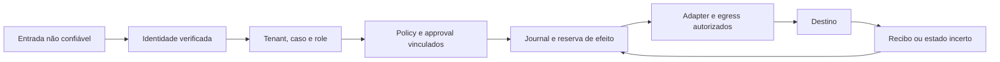

# PHASE 10 — modelo de ameaças das integrações

## UP91-024 — atualização normativa de 23/10/2026

Estado desta entrega: `DOCUMENTED_LOCAL_T1 / PRODUCTION_NO_GO`. Este adendo
atualiza o [cartão UP91-024](../03_build/0367_program_backlog_reaudit_2026-09-30.md#up91-024).
Método: inspeção estática de fontes e negativos existentes; execução de testes,
pentest, qualificação de credenciais, destino e implantação: `NOT_RUN` nesta
rodada. Controle descrito e teste localizado não significam controle aprovado
no ambiente. Nenhum risco residual foi aceito ou rebaixado.

A fonte técnica é o snapshot publicado `2e5a64def639ddfebb3f0b81ccc8b8fcf3419d7b`,
observado como base `main` do PR29. O checkout compartilhado continua em
`3704e3f8`; não foi atualizado para fazer esta revisão. O
[manifesto de fontes](../04_audit/evidence/IDLE-CLOSURE-20261023/up91-024-threat-model/source-manifest.json)
vincula commit, blob Git, SHA-256 e cópia dos arquivos inspecionados. As
referências de código abaixo apontam para esse snapshot, preservando a
distinção entre fonte publicada, candidata privada e prova de execução.

### Ativos, atores e fronteiras

Conforme a [ADR-010](../architecture/adrs/ADR-010-harness-product-isolation.md),
o harness protege identidade, tenant, caso, grants, policy, approvals,
operações, efeitos, segredos e evidências reutilizáveis. O Assistente de
Plantão protege seus próprios dados, fontes, confirmações, lembretes,
journal, canal e recuperação, com os gates PISO e a barra0368. A extração
estrutural não concede independência aceita, acesso cruzado ou produção.

Texto de usuário, modelo, documento, webhook e resposta de fornecedor são
dados não confiáveis. Cookie autentica uma sessão; grant não substitui role;
metadado de fonte não autentica seu conteúdo; resposta perdida não comprova
ausência de efeito. O componente que decide ou grava o recurso conserva a
responsabilidade pela autorização e pela auditoria. UNKNOWN exige
reconciliação ou handoff, sem repetir automaticamente uma ação sensível.

Fluxo de autoridade exigido para uma integração governada:

Este é o modelo normativo de autoridade, não uma declaração de que todo
consumidor já compõe esse caminho. O consumo público e as fronteiras de
processo/import continuam sujeitos a HISO-005/009/013/014.

### Ameaças, controles, negativos e responsáveis

Todos os negativos indicados como existentes foram **localizados na fonte**,
sem execução nesta rodada. `Exigido` identifica prova ainda necessária, sem
transformar ausência de evidência em resultado de teste. Os responsáveis
abaixo são funções/cartões; claims de execução continuam canônicos.

| ID / fronteira                    | Ameaça e controle inspecionado                                                                                                                                                                                                                                         | Negativo localizado ou exigido                                                                                                                                                                                                            | Responsável, gate e residual                                                                                                                                                                                                                    |
| --------------------------------- | ---------------------------------------------------------------------------------------------------------------------------------------------------------------------------------------------------------------------------------------------------------------------- | ----------------------------------------------------------------------------------------------------------------------------------------------------------------------------------------------------------------------------------------- | ----------------------------------------------------------------------------------------------------------------------------------------------------------------------------------------------------------------------------------------------- |
| TM01 — tenant/caso                | Operador autenticado enumera ou lê outro caso. [Leitores de caso][tm-case] verificam principal ativo/role/versão e grant no snapshot; ausência, outro tenant e falta de grant convergem em404. Supervisor/Admin conservam o tenant explícito.                          | [F01][tm-case-negative] descreve operador sem associação sem conteúdo; [listas0251][tm-list-negative] filtram antes de COUNT/offset/limit.                                                                                                | UP91-018/API e persistência. Preservar RLS, projeção e teste PG do candidato; leitura permitida não autoriza escrita ou outro tenant.                                                                                                           |
| TM02 — autorização na escrita     | Revogação ganha a corrida entre precheck e mutação. [authorizeCaseMutation][tm-mutation] é uma unidade de leitura; o [handler][tm-server] chama a escrita posteriormente. Isso não prova atomicidade de grant com commit.                                              | O negativo0251 cobre revogação **antes** da requisição. Exigido: revogar entre decisão e commit e comprovar zero efeito quando a revogação vencer a ordem.                                                                                | UP91-018/026, U04 e [SPEC0262](../02_spec/0262_case_mutation_session_revocation.md). Preservar o gate T3 do holder; não generalizar um teste de status/audit atômicos para autorização cross-pool.                                              |
| TM03 — criação/auditoria          | Criação confirma e audit falha, produzindo estado sem causalidade registrada. No [handler de criação][tm-server], criar task e append de audit são chamadas distintas; transição de status já tem port atômico próprio.                                                | Exigido: falha de audit durante criação não deixar task/approval parcial. Conferir a evidência e o contrato específico de U03; não declarar todas as mutações corrigidas pela SPEC0250.                                                   | UP91-018/U03 e SPEC0257, sob seus gates. Ameaça de criação não é autorização para editar o port, schema ou testes do holder.                                                                                                                    |
| TM04 — identidade/sessão          | Header, cookie antigo ou grupo não verificado amplia privilégio. O [callback OIDC][tm-oidc] produz principal antes da sessão; o [hook][tm-session] recusa sessão inválida e falha de store; [principal][tm-principal] não promove drift sob a mesma versão.            | [OIDC routes][tm-oidc-negative]: conflitos de principal, falha de escrita sem sessão e role drift recusados. Isso não demonstra principal atual em todas as rotas nem revogação global entre pools.                                       | UP91-025/026, U04/U08/U09 e SPEC0254/0259/0262. IdP real, cookies nos hosts escolhidos, revogação e autorização no commit exigem evidência própria.                                                                                             |
| TM05 — approval/capability        | Aprovação é reutilizada com outra operação, payload, proposta ou tenant. [Approval engine][tm-approval] valida binding e reserva; papel humano e capability correspondente permanecem necessários.                                                                     | [Operation key][tm-approval-negative]: divergência de chave não muda estado; evidência desconhecida não libera reserva.                                                                                                                   | Mantenedores approval-engine/runtime e UP91-018. Approval não concede ação clínica, financeira, prontuário definitivo ou alteração real de agenda; ação sensível exige approval ou handoff no escopo autorizado.                                |
| TM06 — efeito após POST           | Fornecedor executa, mas ACK é perdido. [Gateway][tm-channel] persiste identidade/hash/reserva e bloqueia retry cego em efeito incerto; [journal do harness][tm-journal] exige reconciliação explícita.                                                                 | [Journal de canal][tm-channel-negative]: falha após send vira incerta; lease vencida/worker tardio não dão segundo envio ou falso sucesso. [Journal do harness][tm-journal-negative] cobre crash após efeito sintético.                   | Channel gateway/runtime e, no consumidor, PISO-004/005. Cancelar espera ou perder socket não desfaz POST; conferir recibo/idempotência do destino antes de reconciliar.                                                                         |
| TM07 — DNS/rebinding/redirect     | Host permitido resolve rede indevida ou muda endereço entre validação e conexão. [Guard][tm-egress] valida todos os endereços, inclusive allowlist, e revalida hops; [transporte Node22][tm-node] fixa IP mantendo Host/SNI e formato de lookup `all:true`.            | [SSRF egress][tm-egress-negative]: resposta DNS mista privada, allowlist para privado, rebinding e redirect privado recusados; [Node22][tm-node-negative] descreve pin com autoridade original e IP inválido.                             | HISO-011/UP91-028 e mantenedores shared/model/channel. Opt-ins de rede local precisam de escopo explícito; allowlist de nome não aprova endereço, payload ou destino operacional.                                                               |
| TM08 — recepção HTTP              | Corpo grande ou HEAD/204/205/304 incompatível causa retenção indevida ou erro de construção da resposta. [Transporte][tm-node] aplica teto e representa respostas sem corpo com null; 2xx excedente e erro remoto conservam tratamentos distintos.                     | [Bound response][tm-body-negative] descreve buffering limitado no Node real antes de Response; [Node22][tm-node-negative] contém casos 204/205/304 e HEAD/head com body null. Execução no candidato/perfil qualificado permanece exigida. | HISO-011/UP91-028, SPEC0248 e gates próprios de0180. Não conceder ao delta0248 autoridade sobre DNS/shared ou sobre toda a recepção de um consumidor.                                                                                           |
| TM09 — prazo/cancelamento         | Guard continua DNS ou outro hop após abort e alcança dispatch tardio. [Lookup][tm-egress] aguarda resolução sem sinal no snapshot; abort do socket HTTP não prova encerramento dessa espera.                                                                           | Exigido: abort prévio/durante DNS inicial e de redirect não alcançar novo fetch, sem renovar deadline por hop. [SPEC0263](../02_spec/0263_egress_dns_cancellation.md) registra caracterizações com fetch injetado, não envio externo.     | U06/HISO-011 e holder0263, T3 próprio. Prova de SSRF/pinning não fecha liveness, contenção ou prazo absoluto; não alterar limites para obter PASS.                                                                                              |
| TM10 — conhecimento               | Fonte revogada, de outro tenant ou apenas cadastrada aparece como resposta institucional. [RAG local][tm-rag] seleciona tenant/publicação e faz handoff sem fonte; [catálogo de metadados][tm-catalog] registra approvedBy no lifecycle. São objetos diferentes.       | [RAG][tm-rag-negative]: ausência, clínica e revogação; [catálogo][tm-catalog-negative]: URL externa/entrada extra recusadas, identidade imutável e isolamento por tenant.                                                                 | RAG/knowledge e dono institucional, D-07/PISO-009. approvedBy de metadado não prova hash do conteúdo ingerido, validade, autoria ou autorização institucional de resposta real.                                                                 |
| TM11 — modelo/payload/saída       | Dado mal classificado alcança provider ou saída injeta instrução/capability. [Router][tm-router] aplica classificação **declarada**, com fallback/substituição explícitos; [output policy][tm-output] redige e encaminha conteúdo inseguro.                            | [Output policy][tm-output-negative]: diagnóstico/medicação inseguros, conteúdo não textual/grande e conhecimento inseguro viram handoff. Classificação correta do payload e minimização requerem prova própria.                           | Model gateway/policy e dono de dados/provider. Texto de modelo não vira grant/approval; NO_MODEL, perfis, budgets e gates do destino são preservados.                                                                                           |
| TM12 — canal/entrada              | Assinatura forjada, replay, troca de canal ou takeover provoca envio indevido. [Webhook security][tm-webhook] valida assinatura/janela e reserva replay; gateway usa journal, tenant explícito e freio de takeover.                                                    | [Webhook][tm-webhook-negative]: tampering, canal substituído, tempo vencido e store indisponível; journal inclui takeover ativo antes de reserva e canal desabilitado sem efeito.                                                         | Mantenedores API/channel e, no produto, PISO-005/006. Segredos, receptor e webhook reais, rotação, permissões do destino e reentrega em staging permanecem gates separados.                                                                     |
| TM13 — evidência/ambiente/consumo | Arquivo, digest, credencial ou execução de outro componente é tratado como aceite do candidato/destino. [ADR-010](../architecture/adrs/ADR-010-harness-product-isolation.md) separa domínio, processo, dados e gates; HISO-010 exige identidade/proveniência da barra. | Exigidos: núcleo sem arquivos/processo do produto com negativo conhecido; atestação e provas do mesmo SHA/configuração; falhas, UNKNOWN e estado incerto preservados. Inventário/hash isolado não é prova de autorização ou execução.     | HISO-005/009/010/013/014 e operação/CI. Reconciliar configDigest, manifest/indexDigest e identidade do engine; jobs/processos próprios precisam de terminal observado. Matriz, implantação e produção não são aceitas por separação documental. |

### Residuals, decisões e encaminhamento

**Ressalva de TM08 — recepção205 observada:** no transporte de modelo pinado,
`readResponse` só aplica `maxResponseBytes` quando `!bodyless`; o laço ainda
coleta chunks antes de construir a resposta. Na caracterização privada em
Node22.23.2, fonte publicada2e5a/SHA34ee9dea, teto16B e HTTP205 com
Content-Length65536, foram recebidos65602B no socket (66headers+65536payload),
com mensagem completa/end, e o transporte resolveu com `Response(null)`.
O canal pinado se comportou de forma distinta: recebeu8192B de payload e
rejeitou com `ResponseTooLargeError`/status205. Isso não é teto físico16B
no socket. Uma campanha14observações/seiscontrolesPASS, inputs byteexatos
antes/depois e recursos próprios encerrados; nenhuma fonte de app alterada.
Memória retida/pico não foram medidos, nem exploração ou alcance no
provider/gateway. Em204/HEAD/304, houve0B de payload tentado antes do cleanup;
esses casos não estabelecem proteção contra corpo efetivamente entregue.
O [relatório e reprodutor](../04_audit/evidence/IDLE-CLOSURE-20261023/tm08-characterization/REPORT.md)
documentam a observação limitada e o parecer independente somente leitura.
O [registro estático anterior](../04_audit/evidence/IDLE-CLOSURE-20261023/up91-024-threat-model/bodyless-residual.json)
permanece preservado: somente seu UNKNOWN de recepção205 de modelo é sucedido
por esta evidência. HISO-011/UP91-028 continuam responsáveis pelo intake,
correção e negativo no candidato/gate vigente, sem elevar teto ou aceitar risco.

As prioridades dos cartões e os aceites humanos permanecem nas carteiras
canônicas. As SPECs0262/0263 são referências de propostas de outros holders;
este adendo não as aprova nem altera suas fontes, schema, limites ou gates.
U03/U04/U06/U08, os critérios HISO e o piloto PISO mantêm seus responsáveis.
Não pedir novamente uma decisão já registrada; conferir hash, alcance,
dependências e autoridade vigente antes de BUILD.

Autenticação real, princípio de menor privilégio das roles de banco,
segregação de segredos, classificação/minimização de dados, egress do destino,
fontes institucionais, recuperação e comportamento entre réplicas continuam
obrigações de ambiente. Um catálogo synthetic/controlled e um teste local
não aprovam conta, fornecedor, fonte ou dado real. Sem fonte institucional
aprovada não há resposta RAG; agenda real não é confirmada, cancelada ou
reagendada automaticamente; ações clínicas, financeiras e prontuário
definitivo seguem vedados. UNKNOWN é entregue ao responsável para
reconciliação ou handoff, sem aceite automático de risco.

O [pacote desta atualização](../04_audit/evidence/IDLE-CLOSURE-20261023/up91-024-threat-model/task.json)
conserva a pré-imagem, a matriz de rastreio, fontes pinadas e verificações
documentais. A edição fecha esta unidade T1 de preparação normativa; o
estado do cartão pai, o aceite de segurança e a produção não são encerrados
por este relatório.

[tm-case]: https://github.com/ricardoakinaga-dev/cvg-operational-harness/blob/2e5a64def639ddfebb3f0b81ccc8b8fcf3419d7b/apps/api/src/case-authorization/case-routes.ts
[tm-case-negative]: https://github.com/ricardoakinaga-dev/cvg-operational-harness/blob/2e5a64def639ddfebb3f0b81ccc8b8fcf3419d7b/apps/api/src/__tests__/case-read-authorization-f01.test.ts
[tm-list-negative]: https://github.com/ricardoakinaga-dev/cvg-operational-harness/blob/2e5a64def639ddfebb3f0b81ccc8b8fcf3419d7b/apps/api/src/__tests__/case-scope-tasks-approvals.test.ts
[tm-mutation]: https://github.com/ricardoakinaga-dev/cvg-operational-harness/blob/2e5a64def639ddfebb3f0b81ccc8b8fcf3419d7b/apps/api/src/case-authorization/case-routes.ts#L409
[tm-server]: https://github.com/ricardoakinaga-dev/cvg-operational-harness/blob/2e5a64def639ddfebb3f0b81ccc8b8fcf3419d7b/apps/api/src/server.ts#L1818
[tm-oidc]: https://github.com/ricardoakinaga-dev/cvg-operational-harness/blob/2e5a64def639ddfebb3f0b81ccc8b8fcf3419d7b/apps/api/src/oidc-routes.ts#L416
[tm-session]: https://github.com/ricardoakinaga-dev/cvg-operational-harness/blob/2e5a64def639ddfebb3f0b81ccc8b8fcf3419d7b/apps/api/src/operator-session-hook.ts
[tm-principal]: https://github.com/ricardoakinaga-dev/cvg-operational-harness/blob/2e5a64def639ddfebb3f0b81ccc8b8fcf3419d7b/apps/api/src/case-principal-producer.ts
[tm-oidc-negative]: https://github.com/ricardoakinaga-dev/cvg-operational-harness/blob/2e5a64def639ddfebb3f0b81ccc8b8fcf3419d7b/apps/api/src/__tests__/oidc-login-routes.test.ts
[tm-approval]: https://github.com/ricardoakinaga-dev/cvg-operational-harness/blob/2e5a64def639ddfebb3f0b81ccc8b8fcf3419d7b/packages/approval-engine/src/engine.ts
[tm-approval-negative]: https://github.com/ricardoakinaga-dev/cvg-operational-harness/blob/2e5a64def639ddfebb3f0b81ccc8b8fcf3419d7b/packages/approval-engine/src/__tests__/approval-operation-key.test.ts
[tm-channel]: https://github.com/ricardoakinaga-dev/cvg-operational-harness/blob/2e5a64def639ddfebb3f0b81ccc8b8fcf3419d7b/packages/channel-gateway/src/gateway.ts#L226
[tm-journal]: https://github.com/ricardoakinaga-dev/cvg-operational-harness/blob/2e5a64def639ddfebb3f0b81ccc8b8fcf3419d7b/packages/harness/src/effect-journal.ts
[tm-channel-negative]: https://github.com/ricardoakinaga-dev/cvg-operational-harness/blob/2e5a64def639ddfebb3f0b81ccc8b8fcf3419d7b/packages/channel-gateway/src/__tests__/channel-effect-journal.test.ts
[tm-journal-negative]: https://github.com/ricardoakinaga-dev/cvg-operational-harness/blob/2e5a64def639ddfebb3f0b81ccc8b8fcf3419d7b/packages/harness/src/__tests__/effect-journal.test.ts
[tm-egress]: https://github.com/ricardoakinaga-dev/cvg-operational-harness/blob/2e5a64def639ddfebb3f0b81ccc8b8fcf3419d7b/packages/shared/src/ssrf.ts#L273
[tm-node]: https://github.com/ricardoakinaga-dev/cvg-operational-harness/blob/2e5a64def639ddfebb3f0b81ccc8b8fcf3419d7b/packages/model-gateway/src/providers/ssrf-node.ts
[tm-egress-negative]: https://github.com/ricardoakinaga-dev/cvg-operational-harness/blob/2e5a64def639ddfebb3f0b81ccc8b8fcf3419d7b/packages/shared/src/__tests__/ssrf-egress.test.ts
[tm-node-negative]: https://github.com/ricardoakinaga-dev/cvg-operational-harness/blob/2e5a64def639ddfebb3f0b81ccc8b8fcf3419d7b/packages/model-gateway/src/__tests__/bound-transport-node22.test.ts
[tm-body-negative]: https://github.com/ricardoakinaga-dev/cvg-operational-harness/blob/2e5a64def639ddfebb3f0b81ccc8b8fcf3419d7b/packages/channel-gateway/src/__tests__/pdsh-016-bound-response.test.ts
[tm-rag]: https://github.com/ricardoakinaga-dev/cvg-operational-harness/blob/2e5a64def639ddfebb3f0b81ccc8b8fcf3419d7b/packages/rag/src/institutional-rag.ts
[tm-catalog]: https://github.com/ricardoakinaga-dev/cvg-operational-harness/blob/2e5a64def639ddfebb3f0b81ccc8b8fcf3419d7b/packages/platform/src/control-plane-store.ts#L563
[tm-rag-negative]: https://github.com/ricardoakinaga-dev/cvg-operational-harness/blob/2e5a64def639ddfebb3f0b81ccc8b8fcf3419d7b/packages/rag/src/__tests__/institutional-rag.test.ts
[tm-catalog-negative]: https://github.com/ricardoakinaga-dev/cvg-operational-harness/blob/2e5a64def639ddfebb3f0b81ccc8b8fcf3419d7b/packages/platform/src/__tests__/knowledge-source-catalog.test.ts
[tm-router]: https://github.com/ricardoakinaga-dev/cvg-operational-harness/blob/2e5a64def639ddfebb3f0b81ccc8b8fcf3419d7b/packages/model-gateway/src/router.ts
[tm-output]: https://github.com/ricardoakinaga-dev/cvg-operational-harness/blob/2e5a64def639ddfebb3f0b81ccc8b8fcf3419d7b/packages/platform/src/output-policy.ts
[tm-output-negative]: https://github.com/ricardoakinaga-dev/cvg-operational-harness/blob/2e5a64def639ddfebb3f0b81ccc8b8fcf3419d7b/packages/platform/src/__tests__/output-policy.test.ts
[tm-webhook]: https://github.com/ricardoakinaga-dev/cvg-operational-harness/blob/2e5a64def639ddfebb3f0b81ccc8b8fcf3419d7b/apps/api/src/webhook-security.ts
[tm-webhook-negative]: https://github.com/ricardoakinaga-dev/cvg-operational-harness/blob/2e5a64def639ddfebb3f0b81ccc8b8fcf3419d7b/apps/api/src/__tests__/webhook-security.test.ts

## Registro histórico — PR-306, 27/09/2026

- Estado: `PR-306 DOCUMENTED_LOCAL / PRODUCTION_NO_GO`, revisão de 27/09/2026.
  Este inventário descreve código e testes com dados sintéticos; não autoriza
  provider, canal, fonte, agenda, operador ou dado real.
- Escopo: CVG Operational Harness como plataforma. Fronteiras: entrada de
  canal → API → tenant/policy → agente → conhecimento/provider → approval →
  outbox/efeito; operador → IdP/sessão → API; CI → evidência de release.
- Método: STRIDE e falha fechada em capacidades sensíveis. Os testes abaixo
  existem no repositório, mas não foram executados especificamente nesta
  revisão documental. O [backlog de produção](../03_build/0356_production_backlog_2026-09-26.md)
  e as [13 condições de GO](../03_build/0354_production_executive_plan_2026-09-26.md)
  definem o aceite futuro.

## Ativos e invariantes

Identidade de operador/tenant, dados de conversa, fonte institucional,
credenciais de provider/canal, orçamento, drafts de agenda, approvals,
journal/outbox e evidência de auditoria são ativos protegidos. A origem do
canal e o conteúdo recuperado são não confiáveis. Texto do modelo nunca
concede capability, troca tenant ou aprova efeito. Sem fonte institucional
aprovada, o catálogo local retorna handoff; a conversa atual emite texto de
indisponibilidade e permanece `ACTIVE`, sem conteúdo documental recuperado.
Handoff obrigatório nesse caminho ainda é lacuna da PR-504. Consulta real não é confirmada,
cancelada ou reagendada automaticamente; ação clínica, financeira e
prontuário definitivo não são executados. Todo efeito sensível precisa de
approval ou handoff.

## Matriz de ameaças, controles e provas

`Local` significa teste de unidade, integração sintética ou processo
controlado. `Pendente` identifica a prova necessária antes de habilitar a
integração real; um adapter existente não equivale a essa prova.

| ID / STRIDE | Ameaça e fronteira                                                                                          | Controle atual e prova local                                                                                                                                                                                                                                                                                                                                                                                                                                                                         | Prova pendente para produção                                                                                                                                                                                                                     |
| ----------- | ----------------------------------------------------------------------------------------------------------- | ---------------------------------------------------------------------------------------------------------------------------------------------------------------------------------------------------------------------------------------------------------------------------------------------------------------------------------------------------------------------------------------------------------------------------------------------------------------------------------------------------- | ------------------------------------------------------------------------------------------------------------------------------------------------------------------------------------------------------------------------------------------------ |
| C1 / S,T,R  | Webhook forjado, canal trocado, timestamp vencido ou replay entra como mensagem de outro tenant.            | HMAC, janela de tempo e reserva de replay em [webhook-security.ts](../../apps/api/src/webhook-security.ts); casos negativos em [webhook-security.test.ts](../../apps/api/src/__tests__/webhook-security.test.ts) e isolamento em [tenant-inbound-isolation.test.ts](../../apps/api/src/__tests__/tenant-inbound-isolation.test.ts).                                                                                                                                                                  | PR-503: segredo rotacionado em cofre, tenant derivado de identidade do canal, webhook real em staging, reentrega e store distribuído com falha fechada.                                                                                          |
| C2 / T,D    | Retry ou takeover humano duplica envio ou deixa o agente falar depois do handoff.                           | Idempotência e journal do gateway; duplicação, envio único e takeover em [channel-gateway.test.ts](../../packages/channel-gateway/src/__tests__/channel-gateway.test.ts).                                                                                                                                                                                                                                                                                                                            | PR-503: adapter real, ack/retry do fornecedor, kill switch, destinatário permitido e reconciliação de mensagens em staging.                                                                                                                      |
| P1 / I,E    | Payload mal classificado envia dado restrito ou segredo ao provider; URL ou redirect aponta à rede interna. | [router.ts](../../packages/model-gateway/src/router.ts) aplica a classificação **declarada**; o runtime publicado usa provider controlado em [model-provider.ts](../../packages/platform/src/model-provider.ts). [model-provider-boundary.test.ts](../../packages/platform/src/__tests__/model-provider-boundary.test.ts) rejeita provider externo nesse runtime; [ssrf-egress.test.ts](../../packages/shared/src/__tests__/ssrf-egress.test.ts) cobre destino/redirect, não o conteúdo transmitido. | PR-501/502 e D-05: provar classificação confiável e minimização do payload, inclusive segredo mal classificado; DPA, região, retenção e egress em staging. Nenhuma chamada externa do runtime publicado foi qualificada.                         |
| P2 / D      | Retry, timeout, breaker ou custo excessivo consome orçamento e degrada o serviço.                           | Orçamento, timeout e breaker do gateway em [gateway.test.ts](../../packages/model-gateway/src/__tests__/gateway.test.ts); provider local lento em [local-http-providers.test.ts](../../packages/model-gateway/src/__tests__/local-http-providers.test.ts).                                                                                                                                                                                                                                           | PR-501/502: orçamento durável por tenant, limite financeiro aprovado, latência/SLO e desligamento em staging; teste de concorrência e falha do medidor.                                                                                          |
| P3 / T,I    | Saída do modelo injeta instrução, conteúdo clínico/financeiro ou segredo na resposta.                       | Política de saída redige PII e converte respostas sensíveis em handoff; variantes negativas em [output-policy.test.ts](../../packages/platform/src/__tests__/output-policy.test.ts).                                                                                                                                                                                                                                                                                                                 | PR-501/502: avaliação adversarial com provider escolhido e logs redigidos, inclusive resposta malformada, prompt injection e fallback sob falha.                                                                                                 |
| T1 / I,E    | Tool recebe dado sensível e o exfiltra para destino não autorizado.                                         | [tool-invocation-boundary.ts](../../packages/platform/src/tool-invocation-boundary.ts) valida schema e limita tamanho/profundidade do input; [tool-invocation-boundary.test.ts](../../packages/platform/src/__tests__/tool-invocation-boundary.test.ts) rejeita input malformado, grande ou cíclico. Isso **não** impõe política de destino de saída.                                                                                                                                                | PR-505/507: catálogo de destinos e capacidades por tenant, egress restrito e teste negativo com tool falsa que tenta enviar segredo a domínio não permitido; nenhum adapter externo pode ser liberado antes dessa prova.                         |
| R1 / T,I    | Fonte não publicada, revogada ou de outro tenant aparece como resposta institucional.                       | Catálogo local publica/revoga por tenant; ausência, revogação e isolamento em [institutional-rag.test.ts](../../packages/rag/src/__tests__/institutional-rag.test.ts). Catálogo API guarda **metadados** e rejeita URL externa em [knowledge-source-catalog.test.ts](../../apps/api/src/__tests__/knowledge-source-catalog.test.ts).                                                                                                                                                                 | PR-106/504 e D-07: dono aprovador, hash do conteúdo, versão, validade, ingestão auditada e vínculo conteúdo–metadado; revogação ponta a ponta antes de qualquer RAG real.                                                                        |
| R2 / E,T    | Documento ou citação maliciosa tenta mudar policy, revelar dados ou fabricar fonte.                         | Composição filtra source ID permitido, flag de aprovação e texto inseguro em [conversation-service.ts](../../packages/conversation/src/conversation-service.ts); injeção de resultado e citação em [security-boundary.test.ts](../../tests/phase4a/security-boundary.test.ts).                                                                                                                                                                                                                       | PR-504: corpus institucional aprovado e versionado, teste adversarial de recuperação/citação e handoff quando a fonte não puder ser verificada.                                                                                                  |
| A1 / E,T    | Agente confirma, cancela ou reagenda consulta sem grant ou aprovação.                                       | [capability-action-binding.test.ts](../../packages/agent-runtime/src/__tests__/capability-action-binding.test.ts) rejeita `record.confirm` sem grant e `record.reschedule` disfarçado sob outra capability; `record.cancel` requer approval. O caso de `record.reschedule` com capability correspondente ainda não é provado. [journeys.test.ts](../../legacy/packages/secretary-journeys/src/__tests__/journeys.test.ts) verifica draft bloqueado.                                                  | PR-505/PR-L04: contrato neutro de agenda, efeito externo só após approval humano, confirmação real nunca automática; teste negativo para `record.reschedule` com capability correspondente e integração em staging com fornecedor e kill switch. |
| A2 / T,R    | Approval é reusado para outro payload, tenant, versão ou após consumo.                                      | Binding e consumo único em [engine.ts](../../packages/approval-engine/src/engine.ts); divergência e replay em [runtime-binding.test.ts](../../packages/agent-runtime/src/__tests__/runtime-binding.test.ts) e [approval-engine.test.ts](../../packages/approval-engine/src/__tests__/approval-engine.test.ts).                                                                                                                                                                                       | PR-505: concorrência/restart com journal durável, approver autenticado por IdP e reconciliação do efeito ambíguo em staging.                                                                                                                     |
| I1 / S,E    | Header de operador forjado, token repetido ou tenant trocado amplia papel.                                  | Token HMAC, keyring e replay em [operator-identity.ts](../../apps/api/src/operator-identity.ts); negativos em [identity-trusted-resolver.test.ts](../../apps/api/src/__tests__/identity-trusted-resolver.test.ts), [identity-key-ring-rotation.test.ts](../../apps/api/src/__tests__/identity-key-ring-rotation.test.ts) e [tenant-inbound-isolation.test.ts](../../apps/api/src/__tests__/tenant-inbound-isolation.test.ts).                                                                        | PR-301/302, D-09: IdP OIDC/MFA e RBAC por tenant verificados no caminho publicado, sem headers de simulação.                                                                                                                                     |
| I2 / S,D    | Cookie expira ou é revogado em uma réplica, mas outra o aceita; operador não retoma sessão após recarga.    | Cookie opaco `HttpOnly` e revogação em store injetado nos testes [operator-session.test.ts](../../apps/api/src/__tests__/operator-session.test.ts); web sintética em [trusted-session-app.test.tsx](../../apps/web/src/__tests__/trusted-session-app.test.tsx).                                                                                                                                                                                                                                      | [SPEC T3 0144](../02_spec/0144_trusted_operator_session_production.md): store durável no entrypoint, sessão entre réplicas, recarga por cookie, logout e indisponibilidade. Hoje o entrypoint confiável retorna 503 sem store.                   |
| X1 / T,R    | Estado, log e relatórios de CI são trocados juntos após um gate e o certificado perde proveniência.         | Finalizador local confere par E2E, log, hashes e run; regressões em [ci-bar-e2e-finalizer.test.js](../../tests/ci-bar-e2e-finalizer.test.js).                                                                                                                                                                                                                                                                                                                                                        | [SPEC T3 0147](../02_spec/0147_ci_bar_external_provenance.md): selo externo ao diretório, atestação e verificação remota no mesmo SHA. A crítica I5 manteve REJECT para a prova local mutável.                                                   |

## Riscos abertos e decisões

- **P0 de promoção:** IdP/MFA, sessão durável, certificado atual no mesmo SHA,
  CI remoto e proveniência externa continuam sem aceite. RLS obrigatório no
  boot e roles separadas também aguardam PR-405; testes de isolamento em
  banco não equivalem à configuração do ambiente real.
- **P0 de integração:** D-05 (provider), D-06 (canal), D-07 (fontes) e D-09
  (IdP) precedem as SPECs T3/T4 e testes de staging. O catálogo RAG local
  não guarda `approvedBy` ou hash do conteúdo; o catálogo API atual é de
  metadados, não uma fonte documental aprovada para resposta real. A conversa
  sem evidência aprovada ainda não faz handoff automático.
- **Fronteira de confiança:** não há aceite para operador interno malicioso,
  comprometimento do runner/IdP/provedor ou conformidade legal a partir
  destes testes. Essas ameaças exigem controles operacionais, pentest,
  privacidade e decisão humana nas PR-307/401 e no plano 0354.

Nenhum risco desta seção foi aceito como P2 por este documento. O
[backlog 0356](../03_build/0356_production_backlog_2026-09-26.md) mantém as
pendências abertas e a produção em `NO_GO`.
